# HIT → Consolinno SunSpec Proxy (ESP32)

[Deutsch](README.md) · **English**

Standalone Modbus proxy: **Hoymiles HIT** → **Consolinno HEMS** (SunSpec GEN24 on port **1502**).
The ESP holds the only connection to the HIT and distributes the data to Consolinno, Home Assistant, KNX and
other Modbus clients. You choose which of these services run in the setup wizard; the proxy also works
without Consolinno, e.g. only as a Modbus gateway with KNX or Home Assistant.

Target board: [LILYGO T-Connect-Pro](https://github.com/Xinyuan-LilyGO/T-Connect-Pro) (ESP32-S3, Ethernet W5500, display, touch, RS485). **No PoE**, 12–24 V DC.

Without a display it also runs on the **WT32-ETH01** (ESP32 + LAN8720, 4 MB flash) and the LilyGO T-POE-Pro, see [Build](#build).
There is a [printable DIN rail enclosure (2 modules)](hardware/wt32-din/) for the WT32-ETH01, and one with [3.5 modules](hardware/p4-poe-din/) for the Waveshare ESP32-P4-WIFI6-POE-ETH (`p4-poe-eth`).

Current firmware: **v0.6.0** — [release with firmware for every board](https://github.com/atomi23/hit-sunspec-proxy/releases/tag/v0.6.0)

### New in v0.6.0
- **"Bluetooth" page (T-Connect-Pro only):** Shows the connection state of the LED strip and the last error, switches the strip on and off and sets brightness and color. It shows what the gateway sent last; the strip reports nothing back.
- **Bluetooth log:** Every command sent to the strip is in the event log with its bytes, as is every connection. Error messages now name the reason (not reachable or no matching write channel).

<details>
<summary><b>Older versions</b> (v0.5.23 to v0.5.6)</summary>

### v0.5.23
- **Bluetooth LED strip via KNX (T-Connect-Pro only):** LED strips driven by the *Lotus Lantern* app can be switched (DPT 1.001), dimmed (DPT 5.001) and colored (DPT 232.600) through three KNX objects. Set up with strip search and test under *Settings → KNX*. The commands come from public protocol descriptions and have not yet been tried on a real strip.
- **Web UI:** Decimal numbers follow the selected language (comma or point).
- **HIT inverter:** A truncated RS485 response is reported as an error.
- **Data origin:** Is reset when all data sources have expired.

### v0.5.22
- **HTTPS on Windows:** CA installation steps now select the root certificate store manually, so Chrome trusts the device CA.
- **Log out:** Button on the main pages of the web UI, also over HTTPS. If the browser keeps the login, the hint to close the browser helps.

### v0.5.20
- **Web UI:** Loads the layout with the page instead of requesting it separately after a restart.

### v0.5.19
- **German and English:** Added missing texts in backup and restore, HTTPS, downloads and status messages. New log entries follow the selected language.

### v0.5.18
- **CA download:** Now delivers the certificate file instead of the certificate information as JSON.

### v0.5.17
- **HTTPS without browser warning:** The device CA signs the server certificate; install its CA certificate once as a trusted root CA.
- **Download the CA certificate:** Public and without login at `/api/tls/ca.crt`, also reachable over HTTP.
- **Web UI and OTA stay reachable:** If switching to the CA fails, a matching stored certificate or a self-signed fallback certificate is used. The next boot tries the switch again.

### v0.5.16
- **Logs and history:** Download the event and debug logs as text files and the history data as CSV.
- **Display on the T-Connect-Pro:** Weekly schedule with separate on and off times per weekday. An optional KNX object (DPT 1.001) switches the backlight on or off.
- **Firmware and reset:** Back up and restore settings as JSON. Passwords and the access code can be excluded from the export.

### v0.5.15
- **HIT polling:** Starts only once the network and IP address are ready, so network-related failed attempts at boot no longer end up in the statistics. RS485 and demo are unchanged.
- **Poll interval:** Default is now 30 s. Existing settings are kept; if needed, set **Poll (ms)** under **HIT inverter** to `30000`.

### v0.5.14
- The English web UI now also covers all settings submenus, the logs, and firmware and reset.
- The history has English chart labels for screen readers. On small or short screens the chart areas no longer overlap.
- For OTA, pick the file from the release that matches the board. For the **T-Connect-Pro with display** it is `firmware.bin`, not `firmware-t-poe-pro.bin`.

### v0.5.13
- **New setup wizard** with two paths: *Simple* asks questions ("Do you have a Consolinno HEMS?",
  "Do you have KNX in the house?" …) and switches the services on from the answers; *Expert* shows all fields (ports,
  unit IDs, RS485). Credentials for Hoymiles cloud, Dyness cloud, MQTT, Tasmota and home Wi-Fi are entered
  right in the wizard; both cloud logins can be tested there. German and English
- **Boards without display:** Until setup, the default password `hitproxy1` applies (device Wi-Fi and
  login with `admin`). The wizard requires your own password with at least 8 characters; after that the
  default password is invalid everywhere, and the device Wi-Fi also uses your own password
- **Boards with display** as before: random access code and QR code on the display
- Devices that are already set up keep their existing access code when updating

### v0.5.12
- **Hoymiles cloud without plant ID:** If the field is empty, the proxy takes the account's first plant and
  writes its number to the log. Previously nothing happened without an ID, not even a message
- **Dyness cloud on boards without PSRAM:** The power query returns more than 50 KB and failed for lack of memory;
  it is now read entry by entry. Responses that arrive in pieces no longer abort
- Battery page: serial numbers and error text arrived garbled
- Battery cloud: after a connection error, it retries after 30 s instead of waiting for the full interval

### v0.5.11
- **Device Wi-Fi follows the switch:** If *Keep the device's Wi-Fi network enabled (emergency access)* is off and the device is on the cable,
  the Wi-Fi now really stays off (previously it always ran without home Wi-Fi). As emergency access it turns on
  by itself if the device has no address on the cable for one minute, and off again when the cable is back
- **HTTPS only with enough memory:** The check at boot now also accounts for a browser's parallel
  connections. The **WT32-ETH01** (no PSRAM) therefore always runs over HTTP, even with
  Wi-Fi switched off; boards with PSRAM keep using HTTPS

### v0.5.10
- **Boards without PSRAM (WT32-ETH01):** The settings page arrived empty, and HTTP redirected to an HTTPS that
  dropped every connection for lack of memory, so the UI was unreachable. Pages are now sent
  directly from flash. If the RAM is not enough for HTTPS, it does not start and the UI runs
  over HTTP (shown under *Network and access* and in the log)
- Diagnostic output on the serial port only with the build flag `-DTLS_DIAG=1`

### v0.5.9
- New design **Blueprint** with its own controls: menu bar at the top (at the bottom on phones), settings as a
  sliding sheet, and an energy band instead of the node diagram on the live page. The band width matches
  the power; PV covers the house first, then the battery, then the grid feed-in
- New design **Steel**: light with a dark sidebar
- **Setup on the phone:** In the device Wi-Fi the setup page opens by itself (captive portal)
- Grid power on the live page is also readable in light designs
- New build variant **`p4-poe-eth`** for the [Waveshare ESP32-P4-WIFI6-POE-ETH](https://www.waveshare.com/esp32-p4-wifi6-poe-eth.htm):
  Ethernet with PoE, Wi-Fi via the ESP32-C6; not yet tested on hardware
- Printable screwless DIN rail enclosures (printed-on clip, snap-on lid):
  [WT32-ETH01, 2 modules](hardware/wt32-din/) as a PoE-only variant or with RS485/step-down,
  [ESP32-P4-POE-ETH, 3.5 modules](hardware/p4-poe-din/)
- **Battery data** under *Data sources, Battery*: cell temperatures, cell voltages, charge and discharge limits and
  pack info from the HIT, plus optionally SoC, SoH, cycles and remaining energy from the **Dyness cloud**. The live page
  shows the merged values, Home Assistant and KNX get them as separate data points.
  Dyness: create an app ID and secret in the portal [ems.dyness.com](https://ems.dyness.com) under *Developer center,
  API management* (the secret is shown only once) and enter them under *Battery*; if the
  Home Assistant integration uses the same app ID, both share the request limit

### v0.5.8
- **Feature selection** in the setup wizard and under *Settings, Features*: Consolinno/SunSpec,
  Modbus gateway, Home Assistant, KNX, Tasmota meter and Hoymiles cloud can be selected individually
- Services that are not selected do not start and disappear from the menu and live page; SunSpec (port 1502) can be switched off
- Inverter type prepared as a setting (so far only Hoymiles HIT)
- OTA update from older versions: settings are kept, no new setup wizard

### v0.5.7
- **KNX:** Mapping table grouped by area, rows shaded, invalid or duplicate addresses in red;
  **import/export of group addresses in ETS format** (XML and CSV)
- New build variant **`wt32-eth01`**; `t-poe-pro` fixed (clock, PHY reset, RS485 pins, 16 MB flash, PSRAM per LilyGO)
- CSRF protection: third-party web pages can no longer trigger anything via a stored login
- An OTA update belongs to exactly one request; login is checked before large requests are accepted
- Home Assistant: no more meter readings of 0 before the first data (this caused double-counted energy)
- Cloud: meter readings in Wh are always converted correctly, also below 10 kWh
- "Write to the HIT now" writes the values just saved; "Test HIT" in the setup waits for a fresh poll
- Tasmota: crash with a numeric meter number fixed, credentials URL-encoded
- History survives a power failure while saving; KNX type numbers for current/frequency corrected (14.019/14.033)
- Invalid inputs (port 0, unit ID 0, empty Wi-Fi name …) are no longer saved

### v0.5.6
- HIT poll in its own FreeRTOS task (UI/Consolinno stay responsive)
- Tasmota selectable as live grid meter; optional SunSpec **Model 203** (3-phase spoof from the total + HIT voltages)
- KNX DPT9 scaled correctly; FC16 power limit only after a complete register set
- Web callbacks (poll, HIT write, Tasmota probe) run in the main loop, not in the async task
- Passwords are no longer returned in plain text in `/api/config`
- Robust against `millis()` rollover; platform `espressif32 @ 53.3.13` pinned; custom 16 MB partition table

</details>

## Display on the device

The three pages on the T-Connect-Pro: Live, Strings and grid, System. Demo data.

Under **Settings → Display** you can optionally set up a weekly schedule with one time window per weekday.
An earlier off time applies to the following day; equal times mean on all day. As soon as the clock is
synchronized (Central European local time incl. daylight saving time), the schedule replaces the inactivity timer
and the automatic backlight on HIT faults. The web live view keeps running even with the backlight
switched off.

Under **Settings → KNX** you can assign your own group address to the receive object **Switch display**.
A GroupValueWrite with DPT **1.001** switches on at `1` and off at `0`. A KNX command
overrides the weekly schedule until the next change between on and off; without a schedule the last
command applies until the next switch command or restart. The QR code setup stays lit while the
display is enabled.

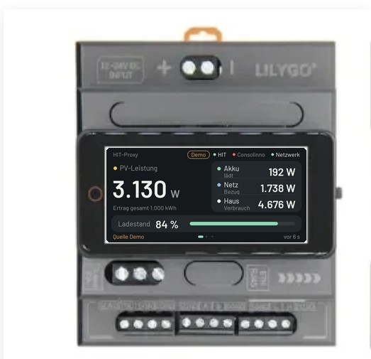
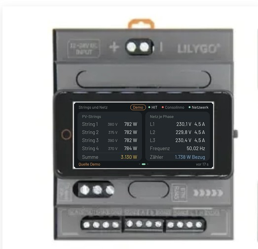
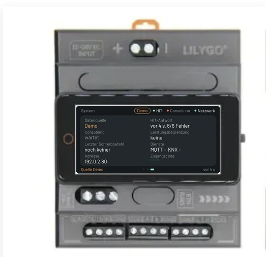

### Bluetooth LED strip by KNX (T-Connect-Pro)

LED strips driven by the **Lotus Lantern** app (Bluetooth names `ELK-BLEDOM…`, `MELK-…`, `LEDBLE…`) can be switched
by KNX. Under **Settings → KNX**, search for the strip, select it, save, and check it with **Test: on/off**. Then
assign group addresses to the receive objects: **switch** (DPT 1.001), **brightness** (DPT 5.001) and **RGB color**
(DPT 232.600). The ESP connects only to send and releases the strip after 10 seconds, because the strip accepts a
single Bluetooth connection; the app on the phone must be closed. Available on the T-Connect-Pro (ESP32-S3) only: the
ESP32 boards lack the memory for Bluetooth and the ESP32-P4 has no Bluetooth. The command set comes from public
protocol descriptions (ELK-BLEDOM).

## Architecture

```
                         ┌── SunSpec :1502 ──→ Consolinno HEMS
Hoymiles HIT ──TCP/RS485─┤── Modbus gateway :502 ──→ Home Assistant, other Modbus clients
   (one connection)      ├── MQTT + Discovery ──→ Home Assistant
          ESP32          ├── KNX IP Routing ──→ KNX bus
                         └── Display, web UI, optional Tasmota meter
```

| Path | Required? | Role |
|------|-----------|------|
| HIT (Modbus TCP or RS485) | yes | Data source, the only connection to the HIT |
| SunSpec :1502 | yes | Consolinno HEMS (GEN24 emulation, models 1/103/120–124/160; optional meter 203) |
| Modbus gateway | no | Other Modbus clients read the HIT through the ESP |
| MQTT | no | HA sensors via discovery, optionally MQTT as fallback source |
| KNX IP | no | Multicast routing of all selectable live values |
| Tasmota | no | Grid meter for the live view and optionally SunSpec model 203 |
| Hoymiles cloud | no | S-Miles read-only, fallback source when HIT and MQTT fail |
| HIT write | no | Battery limits 306–309, APC 279/280, off by default |

## Screenshots

> Original UI from the firmware (HTML/CSS rendered from `WebConfig.cpp`), demo data with RFC 5737 addresses. The screenshots show the German UI.

### Live

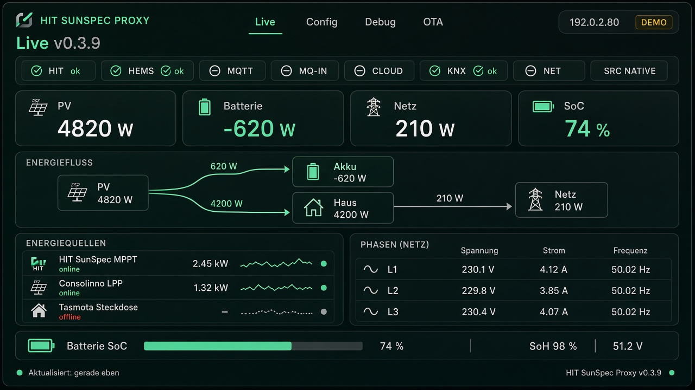

### Blueprint design

Selectable like the other designs, but with its own menu navigation and an energy band on the live page.

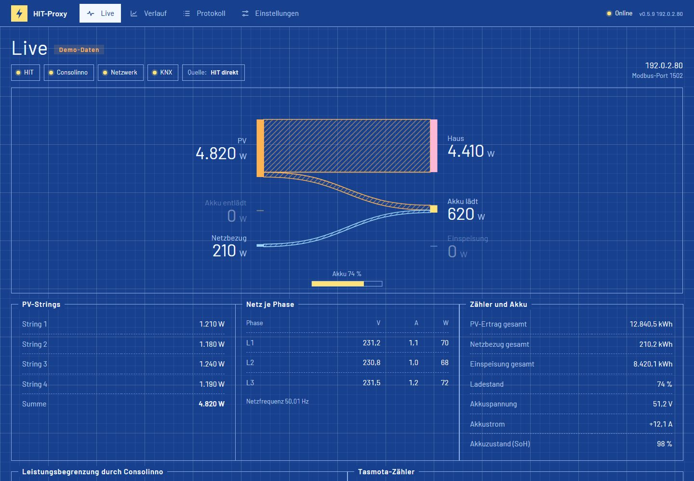

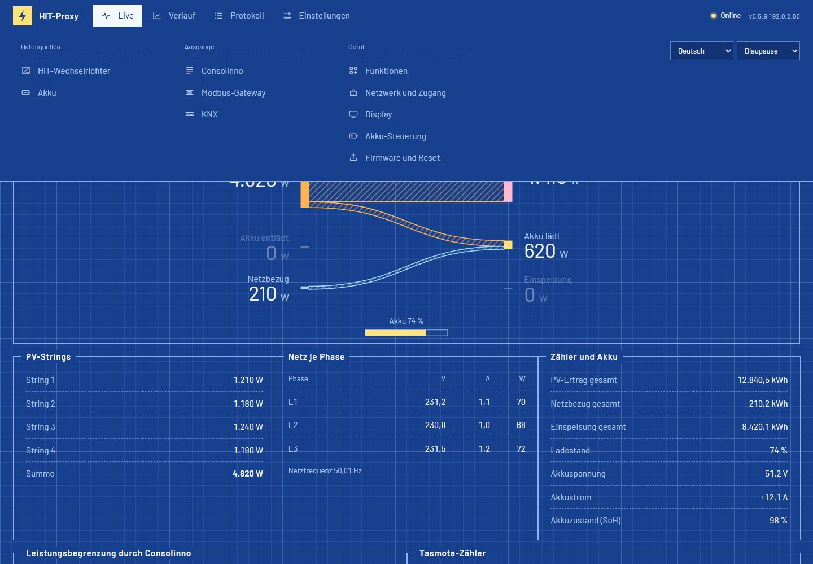

### History

Power balance of the last 24 hours: sources (PV, grid import, battery discharge) above the zero line,
consumers (house, feed-in, battery charge) below it. Below that, energy per day, month, year and total.

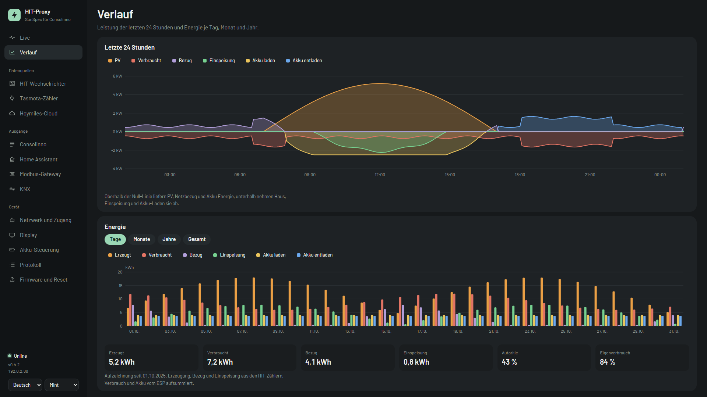

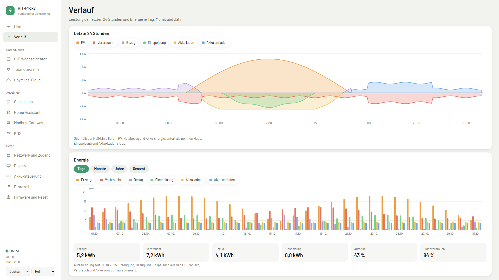

### Log

System log with HIT outages and their cause, recovery, cloud status, OTA and restarts.
Consolinno's §14a write accesses are in the second tab.

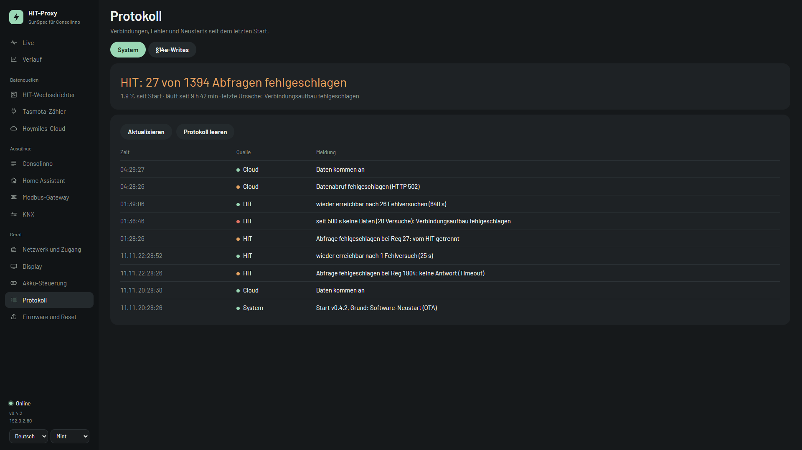

### HTTPS

The device CA signs the server certificate with IP addresses and `<devicename>.local` (820 days).
The CA is created once, issued for about ten years, and survives IP changes and
"Regenerate self-signed"; only a factory reset deletes it. Old self-signed
server certificates are switched over automatically; uploaded custom certificates stay unchanged.
If switching to the CA fails, a matching stored certificate stays in use;
if there is none, a self-signed fallback certificate is created. The next boot tries the CA again.
The fallback may trigger a browser warning. Without a running HTTPS server there is no HTTP redirect.

For HTTPS without a browser warning, choose **Download CA certificate** under *Network and access*
(`/api/tls/ca.crt`, public and also reachable over HTTP; contains no private key). Compare the displayed CA SHA-256 fingerprint
over a trusted connection and install the CA once per client as a root CA:
- Windows:
  1. Double-click `hit-proxy-ca.crt` → **Install Certificate** → **Current User**.
  2. **Place all certificates in the following store** → **Browse** → choose **Trusted Root Certification Authorities**; finish the installation and confirm the security prompt with **Yes**.
  3. Restart the browser completely.
  **Important:** Automatic store selection puts the certificate in the wrong store; Chrome then shows `NET::ERR_CERT_AUTHORITY_INVALID`.
- macOS: **Keychain Access**, **Always Trust**
- iOS: **Install Profile**, then enable it under **Certificate Trust Settings**
- Android: install as **CA certificate**
- Firefox: if needed, also import it into Firefox's own certificate store

Then open `https://<ip>` or `https://<name>.local`. On an IP change only the
server certificate is renewed; the CA does not have to be installed again. The CA may only sign names under
`.local` / `.home.arpa` and private IPv4 networks (10/8, 172.16/12, 192.168/16, 169.254/16).
Custom certificates (PEM, also with intermediate certificates) can still be uploaded.

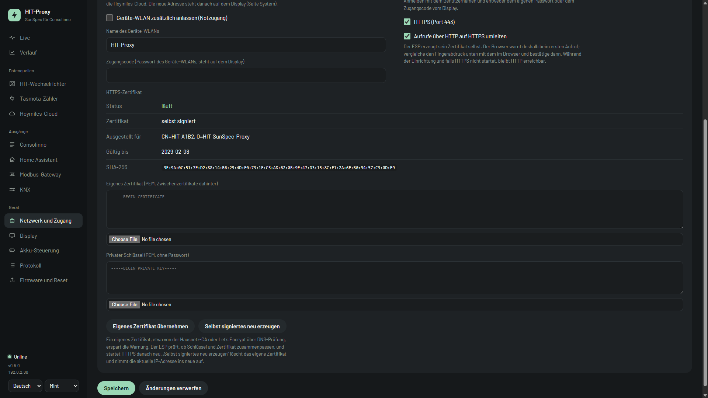

### Settings: HIT inverter and KNX

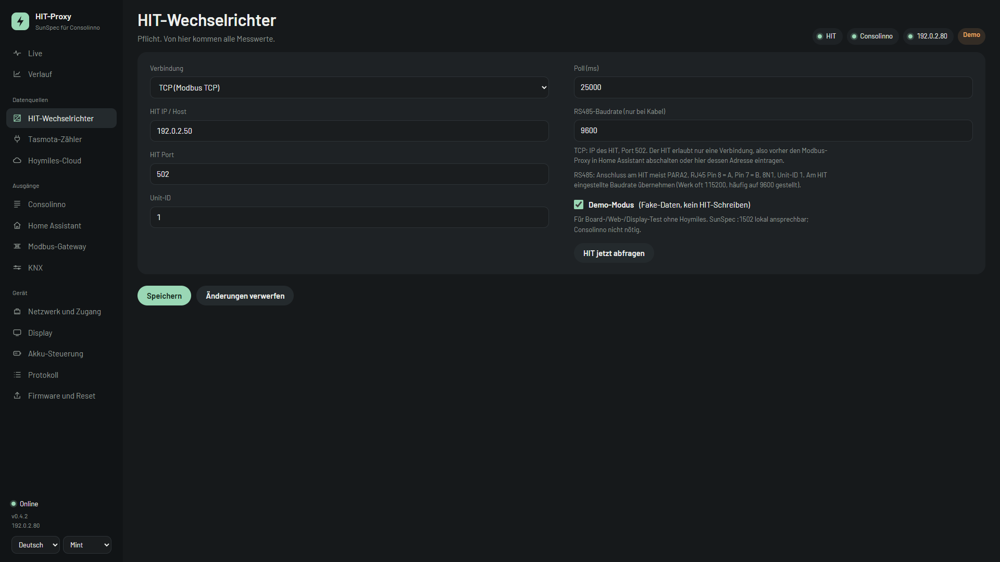

KNX: group address and datapoint type per measurement, grouped by area. The addresses can be downloaded as an
ETS group address export (XML or CSV) and imported into ETS 5/6, or taken over from an ETS export.
Matching uses the description `hit-sunspec-proxy:<id>`, otherwise the name.

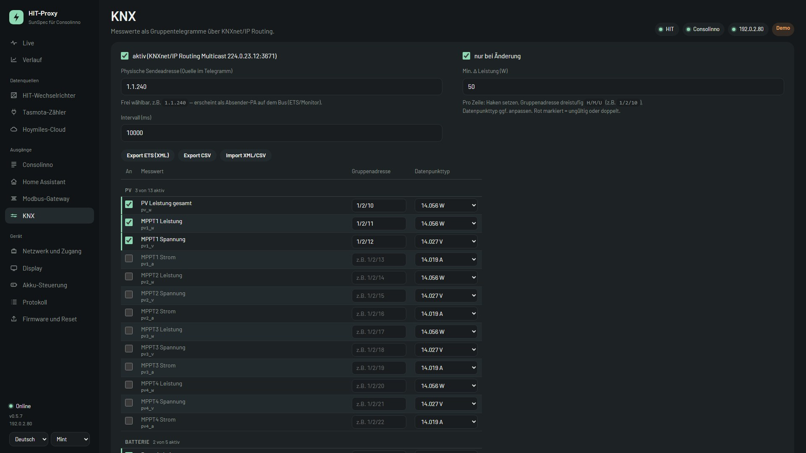

## Features

- **Feature selection** in the setup wizard and under *Settings, Features*: SunSpec for Consolinno,
  Modbus gateway, Home Assistant, KNX, Tasmota and cloud selectable individually; services that are not selected do not start
  and disappear from the menu
- **Battery data** from the HIT (cells, temperatures, limits, packs) and optionally from the Dyness cloud,
  merged on the live page, Home Assistant and KNX
- **Live page** with energy flow (PV, battery, HIT, grid, house), state-of-charge ring, strings, phases, meters
- **History** stored on the ESP (LittleFS): 24 h in 5-minute steps, days, months, years
- **Two logs:** system (HIT, cloud, OTA, restarts) and Consolinno's §14a write accesses;
  the display shows HIT errors as errors/polls
- UI uses the full browser width
- **Menu by data path:** data sources, outputs, device; one area per menu item
- **Display** 480×222 with anti-aliased Barlow font, three pages (Live, Strings and grid, System),
  adjustable off timeout, wakes up on touch or HIT fault
- **HIT over TCP or RS485** (Modbus RTU, TX 17 / RX 18), one persistent connection for reading and writing
- **Modbus gateway** (port 502): reading always, writing only when enabled, every write access in the log
- **SunSpec** GEN24-compatible, image at address 0, 40000 and 50000
- **Protection of the grid protection range:** FC6 to HIT registers 101–299 is never sent
  (according to Hoymiles V2.8 this loads all factory grid protection values)
- **HTTPS** on port 443, HTTP redirects (except during setup). On boards without PSRAM there is not enough
  memory for it; the UI runs over HTTP there. Certificate signed by the device CA with
  IP address and `<devicename>.local`, renewed automatically on a new IP or before expiry; a custom certificate
  (PEM, also with intermediate certificates) can be uploaded, and the ESP checks that key and certificate match
- **Factory reset**, **restart** (with the last restart reason) and **OTA update** in the web UI
- **Access code** can be regenerated at any time; otherwise it persists across restarts and updates
- **Home Wi-Fi** in addition to the device Wi-Fi (emergency access), changes without restart; the device Wi-Fi can be
  switched off and only comes back if the device gets no address on the cable
- **Live view of the display** in the web UI; live page stays put, automatic page cycling optional
- Designs Mint, Ocean, Ember, Light, Steel and Blueprint (with its own menu bar and energy band);
  German and English (web and display)

## Getting started

1. First flash via USB: `pio run -e t-connect-pro -t upload`  
   (or the release `firmware.bin` under *Firmware and reset* via OTA — if OTA hangs, restart first)
2. Connect to the device Wi-Fi `HIT-Proxy-XXXX`. With display: Wi-Fi name, access code and QR code are shown
   on the display. Without display: password `hitproxy1`, login with `admin` and `hitproxy1`.
3. Setup opens by itself on a phone, otherwise open `http://192.168.4.1/` in a browser. The wizard
   asks what is needed; without a display, setting your own password is mandatory.
4. Consolinno: device as Fronius Hybrid / SunSpec, **proxy IP**, port **1502**, unit ID **1**  
   (a scan on 502 only does not find the proxy while SunSpec listens on 1502)
5. Afterwards the UI runs at `https://<esp-ip>/`. To open it without a warning, download the device CA
   under *Network and access* and install it once as a trusted root CA
   (see [HTTPS](#https)). Alternatively upload your own certificate.

If there is already another SunSpec source, you can compare both:
`python tools/sunspec_check.py <old-source> --compare <esp-ip>`. Other programs that read the HIT via Modbus
then use `<esp-ip>:502` (enable the Modbus gateway).

Pins: [`PINS.md`](PINS.md)

## Tools

| Script | Purpose |
|--------|---------|
| `tools/sunspec_check.py` | Read the SunSpec chain, compare two devices (register offset) |
| `tools/parity_check.py` | Check an existing SunSpec map against the ESP's conversion of the same HIT data (read-only) |
| `tools/make_vlw.py` | Generate display fonts (VLW) from Barlow |
| `tools/embed_fonts.py` | Embed web fonts (WOFF) |
| `tools/https_check.py` | Check HTTPS: redirect, saving, certificate upload/rejection, optionally OTA |
| `tools/esp_soak.py` | Load test of the web UI over HTTP or HTTPS, also with a connection held open |
| `tools/modbus_watch.py` | Read the SunSpec identifier continuously, report slow responses and outages |
| `tools/serial_log.py` | Record the serial log |
| `tools/battery_check.py` | Check battery data via `/api/battery` and show it as a table; `--sign-selftest` checks the Dyness signature |

Credentials for the tools come from `ESP_USER` / `ESP_PASS`, never from the repo.

## Build

```bash
cd hit-sunspec-proxy
pio run -e t-connect-pro
pio run -e t-connect-pro -t upload
```

Platform and partitions are fixed in the repo (`espressif32 @ 53.3.13`, `partitions_16MB.csv`:
2× ~4 MB OTA + ~8 MB LittleFS). After changing the partition table, flash once via USB;
OTA between app slots remains possible afterwards.

| Env | Board | Notes |
|-----|-------|-------|
| `t-connect-pro` (default) | LILYGO T-Connect-Pro, ESP32-S3, 16 MB | Display, touch, W5500, RS485 TX 17 / RX 18 |
| `wt32-eth01` | WT32-ETH01, ESP32, 4 MB | no display; no PSRAM, so the UI runs over HTTP instead of HTTPS; LAN8720 (PHY 1, clock GPIO0, enable GPIO16); RS485 via an external converter with auto direction on IO17 (TX) / IO5 (RX) |
| `t-poe-pro` | [LILYGO T-POE-Pro](https://lilygo.cc/products/t-poe-pro), ESP32-WROVER-E, 16 MB, 8 MB PSRAM | no display; LAN8720 with PoE; RS485 on the board (TX 32 / RX 33) |
| `p4-poe-eth` | [Waveshare ESP32-P4-WIFI6-POE-ETH](https://www.waveshare.com/esp32-p4-wifi6-poe-eth.htm), ESP32-P4, 32 MB, 32 MB PSRAM | no display; IP101 with PoE (MDC 31, MDIO 52, reset 51); Wi-Fi via the ESP32-C6; RS485 via an external converter on GPIO4 (TX) / GPIO5 (RX). Not yet tested on hardware |

### Where to buy

- [Search Amazon.de for LILYGO T-Connect-Pro (Prime filter)](https://www.amazon.de/s?tag=atomi23-21&k=LILYGO+T-Connect-Pro&rh=p_85%3A20943776031)\*
- [Search Amazon.de for LILYGO T-POE-Pro (Prime filter)](https://www.amazon.de/s?tag=atomi23-21&k=LILYGO+T-POE-Pro&rh=p_85%3A20943776031)\*
- [WT32-ETH01 on Amazon.de](https://www.amazon.de/dp/B0CW3DDWZ4?tag=atomi23-21)\*
- [Waveshare ESP32-P4-WIFI6-POE-ETH on Amazon.de](https://www.amazon.de/dp/B0G62SNY9S?tag=atomi23-21)\*

\*As an Amazon Associate I earn from qualifying purchases. Links marked * are affiliate/advertising links.

The WT32-ETH01 uses `min_spiffs.csv` (2× 1.9 MB OTA), the T-POE-Pro uses `partitions_16MB.csv` like the T-Connect-Pro.
The WT32-ETH01 is flashed via a USB-serial adapter on TX0/RX0 (IO0 to GND at power-on):

```bash
pio run -e wt32-eth01 -t upload
```

## Privacy

Only dummy data (RFC 5737 `192.0.2.x`). No real plant values, addresses or credentials in the repo.
Stored passwords (web, MQTT, Tasmota, cloud) are not returned by the API;
empty fields on save leave existing values unchanged.

## Support & Donation

Lead Developer: [atomi23](https://github.com/atomi23)

<a href="https://www.paypal.me/atomi23"></a>

## License

MIT. Font Barlow: SIL Open Font License 1.1 ([`docs/FONT-LICENSE-OFL.txt`](docs/FONT-LICENSE-OFL.txt)).
