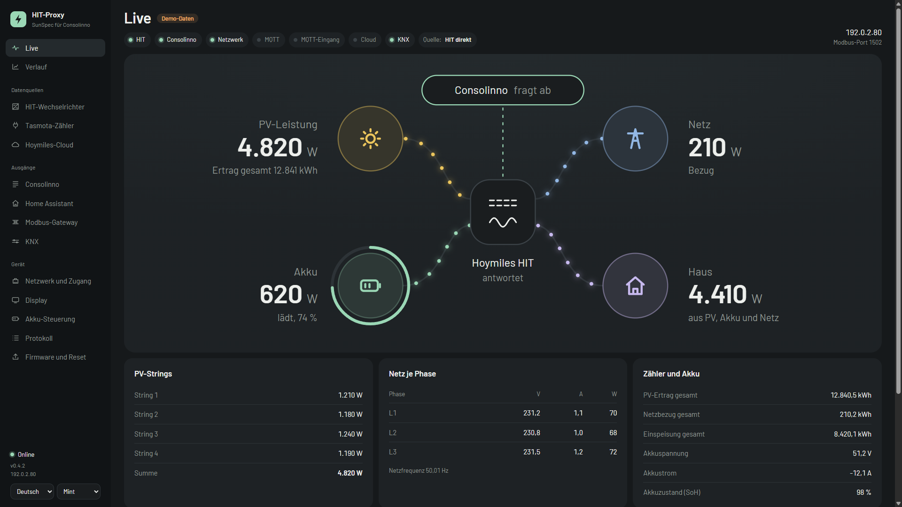
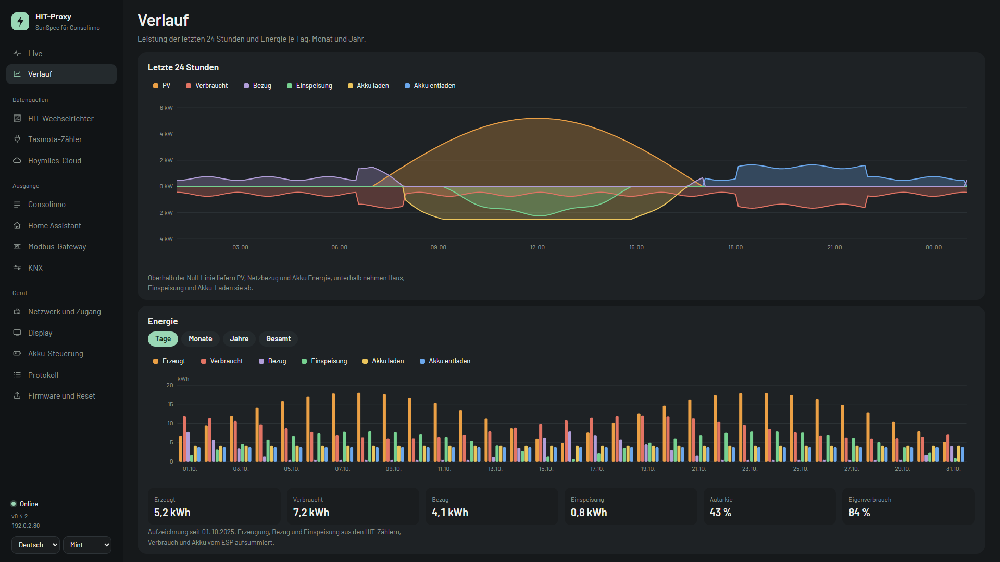
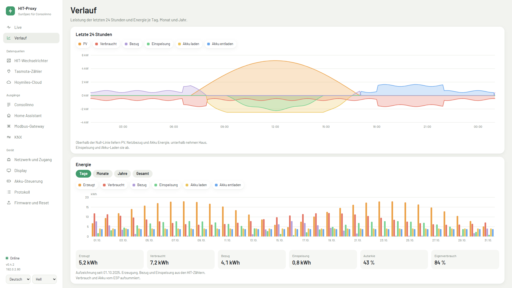
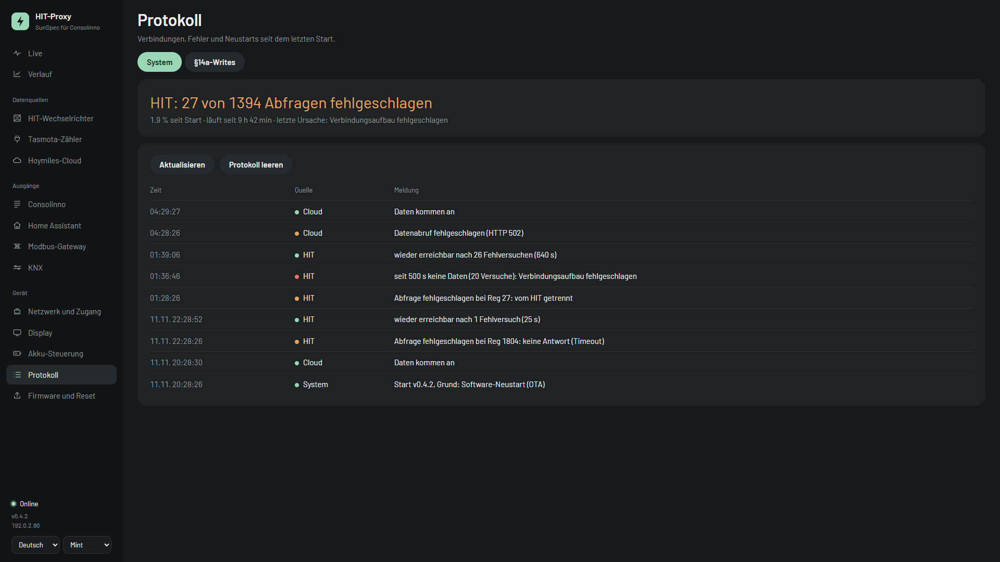
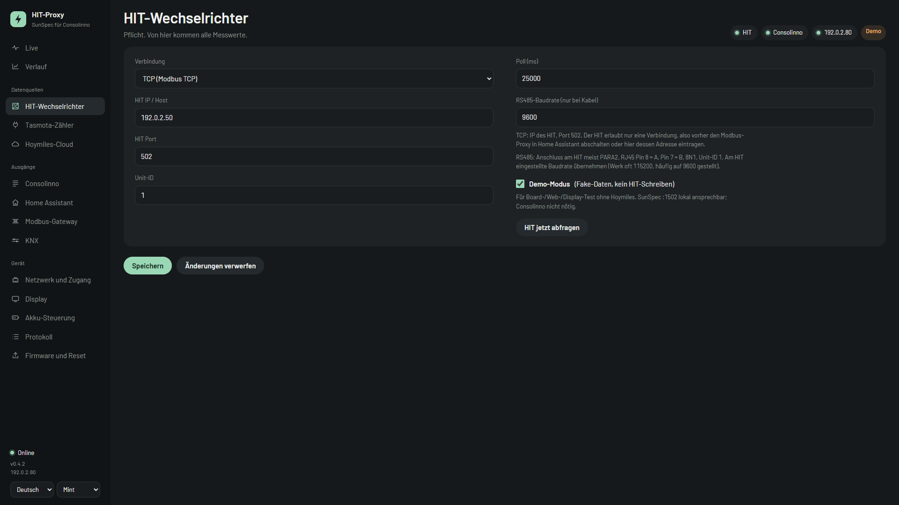
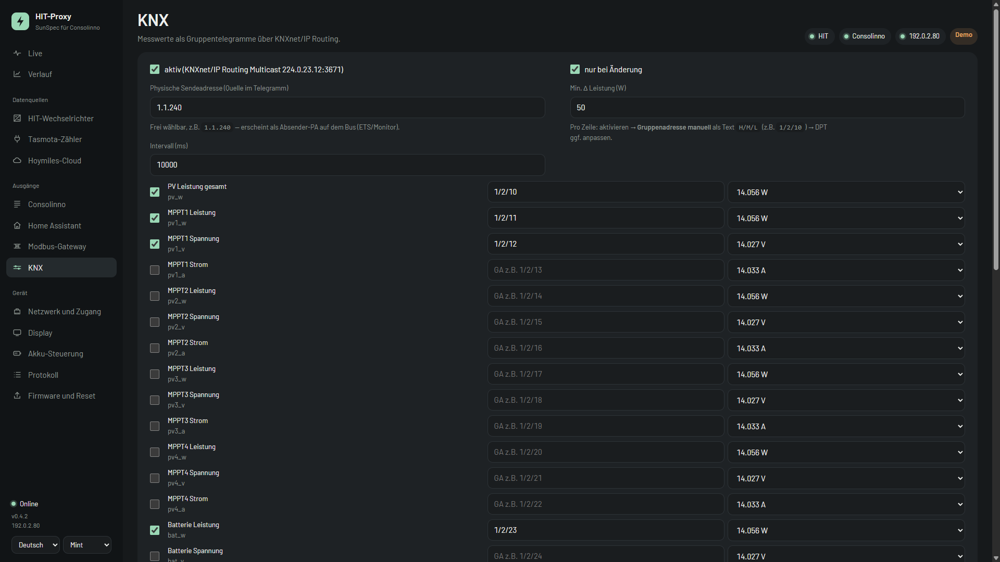

# HIT → Consolinno SunSpec Proxy (ESP32)

Autarker Modbus-Proxy: **Hoymiles HIT** → **Consolinno HEMS** (SunSpec GEN24 auf Port **1502**).
Ersetzt Node-RED und den Modbus-Proxy in Home Assistant: Der ESP hält die einzige HIT-Verbindung und
verteilt die Daten an Consolinno, Home Assistant, KNX und andere Modbus-Clients.

Zielboard: [LILYGO T-Connect-Pro](https://github.com/Xinyuan-LilyGO/T-Connect-Pro) (ESP32-S3, Ethernet W5500, Display, Touch, RS485). **Kein PoE**, 12–24 V DC.

Aktuelle Firmware: **v0.4.2**

## Architektur

```
                         ┌── SunSpec :1502 ──→ Consolinno HEMS
Hoymiles HIT ──TCP/RS485─┤── Modbus-Gateway :502 ──→ Home Assistant, Node-RED, …
   (eine Verbindung)     ├── MQTT + Discovery ──→ Home Assistant
          ESP32          ├── KNX IP Routing ──→ KNX-Bus
                         └── Display, Web-UI
```

| Pfad | Pflicht? | Rolle |
|------|----------|--------|
| HIT (Modbus TCP oder RS485) | ja | Datenquelle, einzige Verbindung zum HIT |
| SunSpec :1502 | ja | Consolinno HEMS (GEN24-Emulation, Modelle 1/103/120/121/122/123/160/124) |
| Modbus-Gateway | nein | HA & Co. lesen den HIT über den ESP (ersetzt den HA-Modbus-Proxy) |
| MQTT | nein | HA-Sensoren per Discovery, optional MQTT als Ersatzquelle |
| KNX IP | nein | Multicast-Routing aller wählbaren Live-Werte |
| Tasmota | nein | Netzzähler, optional als SunSpec Model 201 |
| Hoymiles-Cloud | nein | S-Miles nur lesen, Ersatzquelle wenn HIT und MQTT ausfallen |
| HIT-Schreiben | nein | Akku-Grenzen 306–309, APC 279/280, standardmäßig aus |

## Screenshots

> Original-Oberfläche aus der Firmware (HTML/CSS aus `WebConfig.cpp` gerendert), Demo-Daten mit RFC‑5737-Adressen.

### Live



### Verlauf

Leistungsbilanz der letzten 24 Stunden: Quellen (PV, Netzbezug, Akku entladen) über der Null-Linie,
Verbraucher (Haus, Einspeisung, Akku laden) darunter. Darunter Energie je Tag, Monat, Jahr und gesamt.





### Protokoll

Systemprotokoll mit HIT-Ausfällen samt Ursache, Wiederkehr, Cloud-Status, OTA und Neustarts.
Die §14a-Writes von Consolinno stehen im zweiten Reiter.



### Einstellungen: HIT-Wechselrichter und KNX





## Funktionen

- **Live-Seite** mit Energiefluss (PV, Akku, HIT, Netz, Haus), Ladestand-Ring, Strings, Phasen, Zählern
- **Verlauf** im ESP gespeichert (LittleFS): 24 h in 5-Minuten-Schritten, Tage, Monate, Jahre
- **Zwei Protokolle:** System (HIT, Cloud, OTA, Neustarts) und §14a-Writes von Consolinno;
  das Display zeigt HIT-Fehler als Fehler/Abfragen
- Oberfläche nutzt die volle Browserbreite
- **Menü nach Datenweg:** Datenquellen, Ausgänge, Gerät; ein Bereich pro Menüpunkt
- **Display** 480×222 mit kantengeglätteter Barlow-Schrift, drei Seiten (Live, Strings und Netz, System),
  einstellbarer Abschalt-Timeout, wacht bei Berührung oder HIT-Störung auf
- **HIT über TCP oder RS485** (Modbus RTU, TX 17 / RX 18), eine dauerhafte Verbindung für Lesen und Schreiben
- **Modbus-Gateway** (Port 502): Lesen immer, Schreiben nur mit Freigabe, jeder Schreibzugriff im Protokoll
- **SunSpec** registergleich zur bisherigen Node-RED-Lösung, Abbild ab Adresse 0, 40000 und 50000
- **Schutz des Netzschutz-Bereichs:** FC6 auf HIT-Register 101–299 wird nie gesendet
  (laut Hoymiles V2.8 lädt das alle Netzschutz-Werkswerte)
- **Werksreset**, **Neustart** (mit letztem Neustartgrund) und **OTA-Update** in der Weboberfläche
- **Zugangscode** jederzeit neu erzeugen; bleibt sonst über Neustarts und Updates erhalten
- **Heim-WLAN** zusätzlich zum Geräte-WLAN (Notzugang), Änderungen ohne Neustart
- **Live-Ansicht des Displays** in der Weboberfläche; Live-Seite bleibt stehen, automatisches Blättern optional
- Themes Mint, Ocean, Ember und Hell; Deutsch und Englisch (Web und Display)

## Inbetriebnahme

1. Erstes Flashen per USB: `pio run -e t-connect-pro -t upload`
2. Das Display zeigt WLAN-Name, Passwort und einen QR-Code. Mit dem Geräte-WLAN verbinden.
3. Browser `http://192.168.4.1/` → Einrichtung (HIT-Adresse, Netzwerk)
4. Consolinno: Proxy-IP, Port **1502**, Unit-ID **1**

Umstieg von Node-RED / HA-Modbus-Proxy:

1. Paralleltest: im ESP als HIT-Adresse den bisherigen Modbus-Proxy eintragen, dann
   `python tools/sunspec_check.py <node-red-host> --compare <esp-ip>`
2. Umschalten: Modbus-Proxy in HA stoppen, im ESP den HIT direkt eintragen, Gateway einschalten,
   HA-Modbus-Ziel auf `<esp-ip>:502`, Consolinno auf `<esp-ip>:1502`

Pins: [`PINS.md`](PINS.md)

## Werkzeuge

| Skript | Zweck |
|--------|-------|
| `tools/sunspec_check.py` | SunSpec-Kette lesen, zwei Geräte vergleichen (Registerversatz) |
| `tools/parity_check.py` | Node-RED-Karte gegen die ESP-Umrechnung derselben HIT-Daten prüfen (nur lesend) |
| `tools/make_vlw.py` | Display-Schriften (VLW) aus Barlow erzeugen |
| `tools/embed_fonts.py` | Web-Schriften (WOFF) einbetten |

## Build

```bash
cd hit-sunspec-proxy
pio run -e t-connect-pro
pio run -e t-connect-pro -t upload
```

## Privatsphäre

Nur Pseudodaten (RFC‑5737 `192.0.2.x`). Keine echten Anlagenwerte, Adressen oder Zugangsdaten im Repo.

## Support & Donation

Lead Developer: [atomi23](https://github.com/atomi23)

<a href="https://www.paypal.me/atomi23"></a>

## Lizenz

MIT. Schrift Barlow: SIL Open Font License 1.1 ([`docs/FONT-LICENSE-OFL.txt`](docs/FONT-LICENSE-OFL.txt)).
