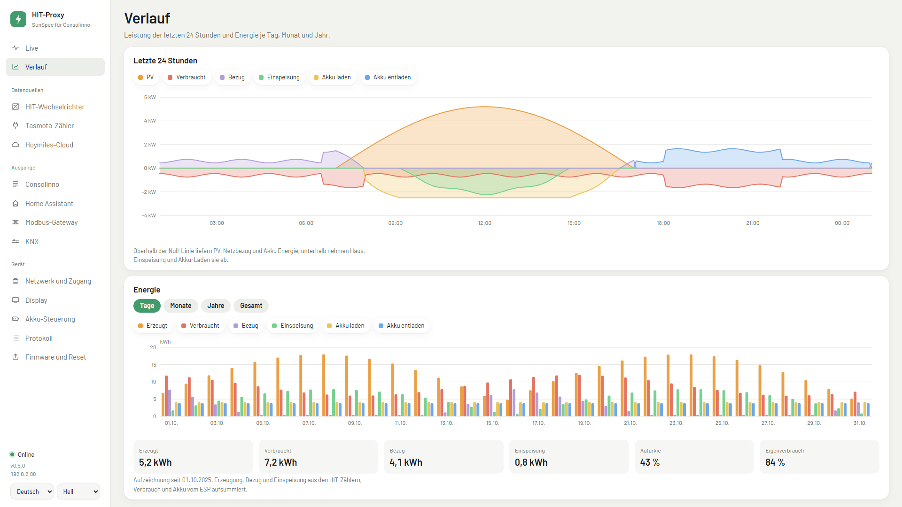
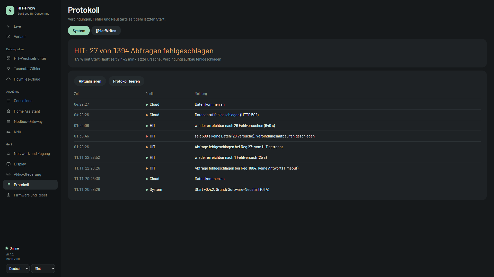

# HIT → Consolinno SunSpec Proxy (ESP32)

Autarker Modbus-Proxy: **Hoymiles HIT** → **Consolinno HEMS** (SunSpec GEN24 auf Port **1502**).
Der ESP hält die einzige HIT-Verbindung und verteilt die Daten an Consolinno, Home Assistant, KNX und
andere Modbus-Clients. Welche dieser Dienste laufen, wählst du im Einrichtungsassistenten; der Proxy
lässt sich auch ganz ohne Consolinno nutzen, z. B. nur als Modbus-Gateway mit KNX oder Home Assistant.

Zielboard: [LILYGO T-Connect-Pro](https://github.com/Xinyuan-LilyGO/T-Connect-Pro) (ESP32-S3, Ethernet W5500, Display, Touch, RS485). **Kein PoE**, 12–24 V DC.

Ohne Display auch auf **WT32-ETH01** (ESP32 + LAN8720, 4 MB Flash) und LilyGO T-POE-Pro, siehe [Build](#build).
Für den WT32-ETH01 gibt es ein [Hutschienengehäuse (2 TE) zum Drucken](hardware/wt32-din/), für den Waveshare ESP32-P4-WIFI6-POE-ETH (`p4-poe-eth`) eines mit [3,5 TE](hardware/p4-poe-din/).

Aktuelle Firmware: **v0.5.18** — [Release mit Firmware für jedes Board](https://github.com/atomi23/hit-sunspec-proxy/releases/tag/v0.5.18)

### Neu in v0.5.18
- **CA-Download:** Liefert jetzt die Zertifikatsdatei statt der Zertifikatsinformationen als JSON.

### Neu in v0.5.17
- **HTTPS ohne Browserwarnung:** Die Geräte-CA signiert das Serverzertifikat; ihr CA-Zertifikat einmal als vertrauenswürdige Stamm-CA installieren.
- **CA-Zertifikat herunterladen:** Öffentlich und ohne Anmeldung unter `/api/tls/ca.crt`, auch über HTTP erreichbar.
- **Weboberfläche und OTA bleiben erreichbar:** Scheitert die CA-Umstellung, wird ein passendes gespeichertes oder ein selbst signiertes Ersatz-Zertifikat verwendet. Der nächste Start versucht die Umstellung erneut.

### Neu in v0.5.16
- **Protokolle und Verlauf:** Ereignis- und Debug-Protokoll als Textdatei, Verlaufsdaten als CSV herunterladen.
- **Display am T-Connect-Pro:** Wochenplan mit eigenen An- und Aus-Zeiten pro Wochentag. Ein optionales KNX-Objekt (DPT 1.001) schaltet die Beleuchtung ein oder aus.
- **Firmware und Reset:** Einstellungen als JSON sichern und wiederherstellen. Passwörter und Zugangscode lassen sich beim Export abwählen.

### v0.5.15
- **HIT-Abfragen:** Starten erst, wenn Netzwerk und IP-Adresse bereit sind. Dadurch landen keine netzwerkbedingten Fehlversuche beim Boot mehr in der Statistik. RS485 und Demo bleiben unverändert.
- **Abfrageintervall:** Standard jetzt 30 s. Bestehende Einstellungen bleiben erhalten; bei Bedarf unter **HIT-Wechselrichter** den Wert **Poll (ms)** auf `30000` setzen.

### v0.5.14
- Die englische Weboberfläche umfasst jetzt auch alle Einstellungs-Untermenüs, Protokolle sowie Firmware und Reset.
- Der Verlauf hat englische Diagrammbeschriftungen für Screenreader. Auf kleinen oder flachen Bildschirmen überlappen die Diagrammbereiche nicht mehr.
- Für OTA die zum Board passende Datei aus dem Release wählen. Beim **T-Connect-Pro mit Display** ist es `firmware.bin`, nicht `firmware-t-poe-pro.bin`.

### v0.5.13
- **Neuer Einrichtungsassistent** mit zwei Wegen: *Einfach* stellt Fragen („Hast du ein Consolinno HEMS?“,
  „Hast du KNX im Haus?“ …) und schaltet die Dienste daraus selbst; *Experte* zeigt alle Felder (Ports,
  Unit-IDs, RS485). Zugangsdaten für Hoymiles-Cloud, Dyness-Cloud, MQTT, Tasmota und Heim-WLAN werden gleich
  im Assistenten eingegeben; die beiden Cloud-Zugänge lassen sich dort testen. Deutsch und Englisch
- **Boards ohne Display:** Bis zur Einrichtung gilt das Standard-Passwort `hitproxy1` (Geräte-WLAN und
  Anmeldung mit `admin`). Der Assistent verlangt ein eigenes Passwort mit mindestens 8 Zeichen; danach ist
  das Standard-Passwort überall ungültig, auch das Geräte-WLAN nutzt dann das eigene Passwort
- **Boards mit Display** wie bisher: zufälliger Zugangscode und QR-Code auf dem Display
- Bereits eingerichtete Geräte behalten beim Update ihren bisherigen Zugangscode

### v0.5.12
- **Hoymiles-Cloud ohne Anlagen-ID:** Bleibt das Feld leer, nimmt der Proxy die erste Anlage des Kontos und
  schreibt ihre Nummer ins Protokoll. Bisher passierte ohne ID nichts, auch keine Meldung
- **Dyness-Cloud auf Boards ohne PSRAM:** Die Leistungsabfrage liefert über 50 KB und scheiterte am Speicher;
  sie wird jetzt Eintrag für Eintrag gelesen. Antworten, die in Stücken ankommen, brechen nicht mehr ab
- Akkuseite: Seriennummern und Fehlertext kamen als Zeichensalat an
- Akku-Cloud: nach einem Verbindungsfehler wird nach 30 s neu versucht statt erst nach dem vollen Intervall

### v0.5.11
- **Geräte-WLAN folgt dem Schalter:** Ist *Geräte-WLAN zusätzlich anlassen* aus und das Gerät hängt am Kabel,
  bleibt das WLAN jetzt wirklich aus (bisher lief es ohne Heim-WLAN immer). Als Notzugang geht es von selbst
  an, wenn das Gerät am Kabel eine Minute lang keine Adresse hat, und wieder aus, wenn das Kabel zurück ist
- **HTTPS nur mit genug Speicher:** Die Prüfung beim Start rechnet jetzt auch den Platz für parallele
  Verbindungen eines Browsers ein. Der **WT32-ETH01** (ohne PSRAM) läuft damit immer über HTTP, auch mit
  abgeschaltetem WLAN; Boards mit PSRAM nutzen weiter HTTPS

### v0.5.10
- **Boards ohne PSRAM (WT32-ETH01):** Die Einstellungsseite kam leer an, und HTTP leitete auf ein HTTPS um, das
  aus Speichermangel jede Verbindung abbrach; die Oberfläche war damit nicht erreichbar. Seiten werden jetzt
  direkt aus dem Flash gesendet. Reicht der RAM nicht für HTTPS, startet es nicht und die Oberfläche läuft
  über HTTP (steht unter *Netzwerk und Zugang* und im Protokoll)
- Diagnose-Ausgaben auf der seriellen Schnittstelle nur noch mit dem Build-Schalter `-DTLS_DIAG=1`

### v0.5.9
- Neues Design **Blaupause** mit eigener Bedienung: Menüleiste oben (am Handy unten), Einstellungen als
  aufklappendes Blatt, auf der Live-Seite ein Energieband statt des Knotenbilds. Die Bandbreite entspricht
  der Leistung; PV deckt dabei zuerst das Haus, dann den Akku, dann die Einspeisung
- Neues Design **Stahl**: hell mit dunkler Seitenleiste
- **Einrichtung am Handy:** Im Geräte-WLAN öffnet sich die Einrichtungsseite von selbst (Captive Portal)
- Netzleistung auf der Live-Seite ist auch in hellen Designs lesbar
- Neue Build-Variante **`p4-poe-eth`** für das [Waveshare ESP32-P4-WIFI6-POE-ETH](https://www.waveshare.com/esp32-p4-wifi6-poe-eth.htm):
  Ethernet mit PoE, WLAN über den ESP32-C6; noch nicht auf Hardware getestet
- Druckbare Hutschienengehäuse ohne Schrauben (Clip angedruckt, Deckel rastet ein):
  [WT32-ETH01, 2 TE](hardware/wt32-din/) als Variante nur PoE oder mit RS485/Step-down,
  [ESP32-P4-POE-ETH, 3,5 TE](hardware/p4-poe-din/)
- **Akkudaten** unter *Datenquellen, Akku*: Zelltemperaturen, Zellspannungen, Lade- und Entladegrenzen und
  Pack-Infos vom HIT, dazu optional SoC, SoH, Zyklen und Restenergie aus der **Dyness-Cloud**. Die Live-Seite
  zeigt die zusammengeführten Werte, Home Assistant und KNX bekommen sie als eigene Datenpunkte.
  Dyness: App-ID und Secret im Portal [ems.dyness.com](https://ems.dyness.com) unter *Entwicklerzentrum,
  API-Verwaltung* anlegen (das Secret steht dort nur einmal) und unter *Akku* eintragen; nutzt die
  Home-Assistant-Integration dieselbe App-ID, teilen sich beide die Abrufgrenze

### v0.5.8
- **Funktionsauswahl** im Einrichtungsassistenten und unter *Einstellungen, Funktionen*: Consolinno/SunSpec,
  Modbus-Gateway, Home Assistant, KNX, Tasmota-Zähler und Hoymiles-Cloud einzeln wählbar
- Nicht gewählte Dienste starten nicht und verschwinden aus Menü und Live-Seite; SunSpec (Port 1502) abschaltbar
- Wechselrichter-Typ als Einstellung vorbereitet (bisher nur Hoymiles HIT)
- Update per OTA von älteren Versionen: Einstellungen bleiben, kein erneuter Einrichtungsassistent

### v0.5.7
- **KNX:** Zuordnungstabelle nach Bereichen gruppiert, Zeilen hinterlegt, ungültige oder doppelte Adressen rot;
  **Import/Export der Gruppenadressen im ETS-Format** (XML und CSV)
- Neue Build-Variante **`wt32-eth01`**; `t-poe-pro` korrigiert (Takt, PHY-Reset, RS485-Pins, 16 MB Flash, PSRAM laut LilyGO)
- Schutz gegen CSRF: fremde Webseiten können über ein gespeichertes Login nichts mehr auslösen
- OTA-Update gehört genau einer Anfrage; Login wird vor dem Annehmen großer Anfragen geprüft
- Home Assistant: keine Zählerstände 0 mehr vor den ersten Daten (verhinderte doppelt gezählte Energie)
- Cloud: Zählerstände in Wh werden immer richtig umgerechnet, auch unter 10 kWh
- „Jetzt an HIT schreiben“ schreibt die gerade gespeicherten Werte; „HIT testen“ im Setup wartet auf eine frische Abfrage
- Tasmota: Absturz bei numerischer Zählernummer behoben, Zugangsdaten URL-kodiert
- Verlauf übersteht einen Stromausfall beim Speichern; KNX-Typnummern für Strom/Frequenz korrigiert (14.019/14.033)
- Ungültige Eingaben (Port 0, Unit-ID 0, leerer WLAN-Name …) werden nicht mehr gespeichert

### v0.5.6
- HIT-Poll in eigener FreeRTOS-Task (UI/Consolinno bleiben responsiv)
- Tasmota wählbar als Live-Netzzähler; optional SunSpec **Model 203** (3ph-Spoof aus Summe + HIT-Spannungen)
- KNX DPT9 korrekt skaliert; FC16 Power-Limit erst nach vollständigem Registersatz
- Web-Callbacks (Poll, HIT-Schreiben, Tasmota-Probe) laufen in der Hauptschleife, nicht im Async-Task
- Passwörter werden in `/api/config` nicht mehr im Klartext ausgeliefert
- `millis()`-Rollover-fest; Platform `espressif32 @ 53.3.13` gepinnt; eigene 16‑MB-Partitionstabelle

## Display am Gerät

Die drei Seiten auf dem T-Connect-Pro: Live, Strings und Netz, System. Demo-Daten.

Unter **Einstellungen → Display** lässt sich optional ein Wochenplan mit einem Zeitfenster pro Wochentag
einrichten. Eine frühere Aus-Zeit gilt am Folgetag, gleiche Zeiten bedeuten ganztägig an. Sobald die Uhr
synchronisiert ist (mitteleuropäische Ortszeit inkl. Sommerzeit), ersetzt der Plan den Inaktivitäts-Timer
und die automatische Beleuchtung bei HIT-Störungen. Die Web-Live-Ansicht läuft auch bei ausgeschalteter
Beleuchtung weiter.

Unter **Einstellungen → KNX** kann man dem Empfangsobjekt **Display schalten** eine eigene Gruppenadresse
zuweisen. Ein GroupValueWrite mit DPT **1.001** schaltet bei `1` ein und bei `0` aus. Ein KNX-Befehl
übersteuert den Wochenplan bis zum nächsten Wechsel zwischen An und Aus; ohne Plan gilt der letzte
Befehl bis zum nächsten Schaltbefehl oder Neustart. Die Einrichtung mit QR-Code wird bei aktiviertem
Display weiterhin beleuchtet.


## Architektur

```
                         ┌── SunSpec :1502 ──→ Consolinno HEMS
Hoymiles HIT ──TCP/RS485─┤── Modbus-Gateway :502 ──→ Home Assistant, andere Modbus-Clients
   (eine Verbindung)     ├── MQTT + Discovery ──→ Home Assistant
          ESP32          ├── KNX IP Routing ──→ KNX-Bus
                         └── Display, Web-UI, optional Tasmota-Zähler
```

| Pfad | Pflicht? | Rolle |
|------|----------|--------|
| HIT (Modbus TCP oder RS485) | ja | Datenquelle, einzige Verbindung zum HIT |
| SunSpec :1502 | ja | Consolinno HEMS (GEN24-Emulation, Modelle 1/103/120–124/160; optional Meter 203) |
| Modbus-Gateway | nein | Andere Modbus-Clients lesen den HIT über den ESP |
| MQTT | nein | HA-Sensoren per Discovery, optional MQTT als Ersatzquelle |
| KNX IP | nein | Multicast-Routing aller wählbaren Live-Werte |
| Tasmota | nein | Netzzähler für Live-View und optional SunSpec Model 203 |
| Hoymiles-Cloud | nein | S-Miles nur lesen, Ersatzquelle wenn HIT und MQTT ausfallen |
| HIT-Schreiben | nein | Akku-Grenzen 306–309, APC 279/280, standardmäßig aus |

## Screenshots

> Original-Oberfläche aus der Firmware (HTML/CSS aus `WebConfig.cpp` gerendert), Demo-Daten mit RFC‑5737-Adressen.

### Live


### Design Blaupause

Wählbar wie die anderen Designs, aber mit eigener Menüführung und einem Energieband auf der Live-Seite.


### Verlauf

Leistungsbilanz der letzten 24 Stunden: Quellen (PV, Netzbezug, Akku entladen) über der Null-Linie,
Verbraucher (Haus, Einspeisung, Akku laden) darunter. Darunter Energie je Tag, Monat, Jahr und gesamt.




### Protokoll

Systemprotokoll mit HIT-Ausfällen samt Ursache, Wiederkehr, Cloud-Status, OTA und Neustarts.
Die §14a-Writes von Consolinno stehen im zweiten Reiter.



### HTTPS

Die Geräte-CA signiert das Serverzertifikat mit IP-Adressen und `<gerätename>.local` (820 Tage).
Die CA wird einmal erzeugt, für etwa zehn Jahre ausgestellt und bleibt bei IP-Wechseln und
„Selbst signiertes neu erzeugen“ erhalten; nur ein Werksreset löscht sie. Alte selbst signierte
Serverzertifikate werden automatisch umgestellt; hochgeladene eigene Zertifikate bleiben unverändert.
Bei einem Fehler der CA-Umstellung bleibt ein passendes gespeichertes Zertifikat in Betrieb;
fehlt es, wird ein selbst signiertes Ersatz-Zertifikat erzeugt. Der nächste Start versucht die CA erneut.
Der Ersatz kann eine Browserwarnung auslösen. Ohne laufenden HTTPS-Server erfolgt keine HTTP-Umleitung.

Für HTTPS ohne Browserwarnung unter *Netzwerk und Zugang* **CA-Zertifikat herunterladen** wählen
(`/api/tls/ca.crt`, öffentlich und auch über HTTP erreichbar; enthält keinen privaten Schlüssel). Den angezeigten CA-SHA-256-Fingerabdruck
über eine vertrauenswürdige Verbindung vergleichen und die CA einmal pro Client als Stamm-CA installieren:
- Windows: **Vertrauenswürdige Stammzertifizierungsstellen**
- macOS: **Schlüsselbund**, **Immer vertrauen**
- iOS: **Profil installieren**, danach unter **Zertifikatsvertrauenseinstellungen** aktivieren
- Android: **CA-Zertifikat** installieren
- Firefox: ggf. zusätzlich in den eigenen Zertifikatsspeicher importieren

Danach `https://<ip>` oder `https://<name>.local` öffnen. Bei einem IP-Wechsel wird nur das
Serverzertifikat erneuert; die CA muss nicht erneut installiert werden. Die CA darf nur Namen unter
`.local` / `.home.arpa` und private IPv4-Netze (10/8, 172.16/12, 192.168/16, 169.254/16) signieren.
Eigene Zertifikate (PEM, auch mit Zwischenzertifikaten) können weiterhin hochgeladen werden.


### Einstellungen: HIT-Wechselrichter und KNX


KNX: je Messwert Gruppenadresse und Datenpunkttyp, nach Bereichen gruppiert. Die Adressen lassen sich als
ETS-Gruppenadressen-Export (XML oder CSV) herunterladen und in ETS 5/6 importieren, oder aus einem ETS-Export
übernehmen. Zugeordnet wird über die Beschreibung `hit-sunspec-proxy:<id>`, sonst über den Namen.


## Funktionen

- **Funktionsauswahl** im Einrichtungsassistenten und unter *Einstellungen, Funktionen*: SunSpec für Consolinno,
  Modbus-Gateway, Home Assistant, KNX, Tasmota und Cloud einzeln wählbar; nicht gewählte Dienste starten nicht
  und verschwinden aus dem Menü
- **Akkudaten** vom HIT (Zellen, Temperaturen, Grenzen, Packs) und optional aus der Dyness-Cloud,
  zusammengeführt auf Live-Seite, Home Assistant und KNX
- **Live-Seite** mit Energiefluss (PV, Akku, HIT, Netz, Haus), Ladestand-Ring, Strings, Phasen, Zählern
- **Verlauf** im ESP gespeichert (LittleFS): 24 h in 5-Minuten-Schritten, Tage, Monate, Jahre
- **Zwei Protokolle:** System (HIT, Cloud, OTA, Neustarts) und §14a-Writes von Consolinno;
  das Display zeigt HIT-Fehler als Fehler/Abfragen
- Oberfläche nutzt die volle Browserbreite
- **Menü nach Datenweg:** Datenquellen, Ausgänge, Gerät; ein Bereich pro Menüpunkt
- **Display** 480×222 mit kantengeglätteter Barlow-Schrift, drei Seiten (Live, Strings und Netz, System),
  einstellbarer Abschalt-Timeout, wacht bei Berührung oder HIT-Störung auf
- **HIT über TCP oder RS485** (Modbus RTU, TX 17 / RX 18), eine dauerhafte Verbindung für Lesen und Schreiben
- **Modbus-Gateway** (Port 502): Lesen immer, Schreiben nur mit Freigabe, jeder Schreibzugriff im Protokoll
- **SunSpec** GEN24-kompatibel, Abbild ab Adresse 0, 40000 und 50000
- **Schutz des Netzschutz-Bereichs:** FC6 auf HIT-Register 101–299 wird nie gesendet
  (laut Hoymiles V2.8 lädt das alle Netzschutz-Werkswerte)
- **HTTPS** auf Port 443, HTTP leitet um (außer während der Einrichtung). Auf Boards ohne PSRAM reicht der
  Speicher dafür nicht; dort läuft die Oberfläche über HTTP. Von der Geräte-CA signiertes Zertifikat mit
  IP-Adresse und `<gerätename>.local`, wird bei neuer IP oder vor Ablauf selbst erneuert; eigenes Zertifikat
  (PEM, auch mit Zwischenzertifikaten) hochladbar, der ESP prüft ob Schlüssel und Zertifikat zusammenpassen
- **Werksreset**, **Neustart** (mit letztem Neustartgrund) und **OTA-Update** in der Weboberfläche
- **Zugangscode** jederzeit neu erzeugen; bleibt sonst über Neustarts und Updates erhalten
- **Heim-WLAN** zusätzlich zum Geräte-WLAN (Notzugang), Änderungen ohne Neustart; das Geräte-WLAN lässt sich
  abschalten und kommt nur zurück, wenn das Gerät am Kabel keine Adresse bekommt
- **Live-Ansicht des Displays** in der Weboberfläche; Live-Seite bleibt stehen, automatisches Blättern optional
- Designs Mint, Ocean, Ember, Hell, Stahl und Blaupause (mit eigener Menüleiste und Energieband);
  Deutsch und Englisch (Web und Display)

## Inbetriebnahme

1. Erstes Flashen per USB: `pio run -e t-connect-pro -t upload`  
   (oder Release-`firmware.bin` unter *Firmware und Reset* per OTA — bei hängendem OTA vorher neu starten)
2. Mit dem Geräte-WLAN `HIT-Proxy-XXXX` verbinden. Mit Display: WLAN-Name, Zugangscode und QR-Code stehen
   auf dem Display. Ohne Display: Passwort `hitproxy1`, Anmeldung mit `admin` und `hitproxy1`.
3. Die Einrichtung öffnet sich am Handy von selbst, sonst Browser `http://192.168.4.1/`. Der Assistent
   fragt ab, was gebraucht wird; ohne Display ist dabei ein eigenes Passwort Pflicht.
4. Consolinno: Gerät als Fronius Hybrid / SunSpec, **Proxy-IP**, Port **1502**, Unit-ID **1**  
   (Scan nur auf 502 findet den Proxy nicht, solange SunSpec auf 1502 lauscht)
5. Danach läuft die Oberfläche über `https://<esp-ip>/`. Für einen Aufruf ohne Warnung die Geräte-CA
   unter *Netzwerk und Zugang* herunterladen und einmal als vertrauenswürdige Stamm-CA installieren
   (siehe [HTTPS](#https)). Alternativ ein eigenes Zertifikat hochladen.

Gibt es schon eine andere SunSpec-Quelle, lassen sich beide vergleichen:
`python tools/sunspec_check.py <alte-quelle> --compare <esp-ip>`. Andere Programme, die den HIT per Modbus
lesen, tragen danach `<esp-ip>:502` ein (Modbus-Gateway einschalten).

Pins: [`PINS.md`](PINS.md)

## Werkzeuge

| Skript | Zweck |
|--------|-------|
| `tools/sunspec_check.py` | SunSpec-Kette lesen, zwei Geräte vergleichen (Registerversatz) |
| `tools/parity_check.py` | Eine bestehende SunSpec-Karte gegen die ESP-Umrechnung derselben HIT-Daten prüfen (nur lesend) |
| `tools/make_vlw.py` | Display-Schriften (VLW) aus Barlow erzeugen |
| `tools/embed_fonts.py` | Web-Schriften (WOFF) einbetten |
| `tools/https_check.py` | HTTPS prüfen: Umleitung, Speichern, Zertifikat hochladen/ablehnen, optional OTA |
| `tools/esp_soak.py` | Lasttest der Weboberfläche über HTTP oder HTTPS, auch mit offen gehaltener Verbindung |
| `tools/modbus_watch.py` | SunSpec-Kennung laufend lesen, langsame Antworten und Ausfälle melden |
| `tools/serial_log.py` | Seriellen Log mitschreiben |
| `tools/battery_check.py` | Akkudaten über `/api/battery` prüfen und als Tabelle zeigen; `--sign-selftest` prüft die Dyness-Signatur |

Zugangsdaten für die Werkzeuge kommen aus `ESP_USER` / `ESP_PASS`, nie aus dem Repo.

## Build

```bash
cd hit-sunspec-proxy
pio run -e t-connect-pro
pio run -e t-connect-pro -t upload
```

Platform und Partitionen sind im Repo festgelegt (`espressif32 @ 53.3.13`, `partitions_16MB.csv`:
2× ~4 MB OTA + ~8 MB LittleFS). Nach einem Partitionstabellen-Wechsel einmal per USB flashen;
OTA zwischen App-Slots bleibt danach möglich.

| Env | Board | Hinweise |
|-----|-------|----------|
| `t-connect-pro` (Standard) | LILYGO T-Connect-Pro, ESP32-S3, 16 MB | Display, Touch, W5500, RS485 TX 17 / RX 18 |
| `wt32-eth01` | WT32-ETH01, ESP32, 4 MB | ohne Display; ohne PSRAM, deshalb Oberfläche über HTTP statt HTTPS; LAN8720 (PHY 1, Takt GPIO0, Enable GPIO16); RS485 über externen Wandler mit Auto-Richtung an IO17 (TX) / IO5 (RX) |
| `t-poe-pro` | [LILYGO T-POE-Pro](https://lilygo.cc/products/t-poe-pro), ESP32-WROVER-E, 16 MB, 8 MB PSRAM | ohne Display; LAN8720 mit PoE; RS485 auf der Platine (TX 32 / RX 33) |
| `p4-poe-eth` | [Waveshare ESP32-P4-WIFI6-POE-ETH](https://www.waveshare.com/esp32-p4-wifi6-poe-eth.htm), ESP32-P4, 32 MB, 32 MB PSRAM | ohne Display; IP101 mit PoE (MDC 31, MDIO 52, Reset 51); WLAN über den ESP32-C6; RS485 über externen Wandler an GPIO4 (TX) / GPIO5 (RX). Noch nicht auf Hardware getestet |

Der WT32-ETH01 nutzt `min_spiffs.csv` (2× 1,9 MB OTA), der T-POE-Pro wie der T-Connect-Pro `partitions_16MB.csv`.
Der WT32-ETH01 wird über einen USB-Seriell-Adapter an TX0/RX0 geflasht (IO0 beim Einschalten auf GND):

```bash
pio run -e wt32-eth01 -t upload
```

## Privatsphäre

Nur Pseudodaten (RFC‑5737 `192.0.2.x`). Keine echten Anlagenwerte, Adressen oder Zugangsdaten im Repo.
Gespeicherte Passwörter (Web, MQTT, Tasmota, Cloud) werden über die API nicht ausgeliefert;
leere Felder beim Speichern lassen bestehende Werte unverändert.

## Support & Donation

Lead Developer: [atomi23](https://github.com/atomi23)

<a href="https://www.paypal.me/atomi23"></a>

## Lizenz

MIT. Schrift Barlow: SIL Open Font License 1.1 ([`docs/FONT-LICENSE-OFL.txt`](docs/FONT-LICENSE-OFL.txt)).
