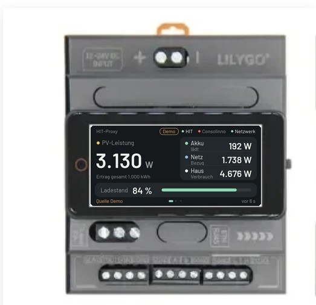
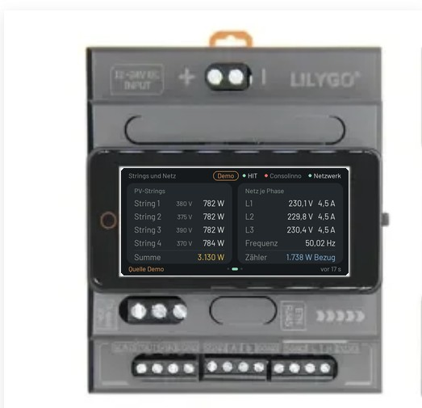
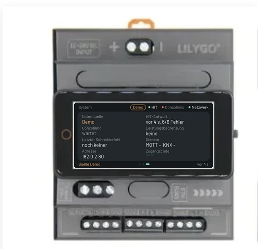
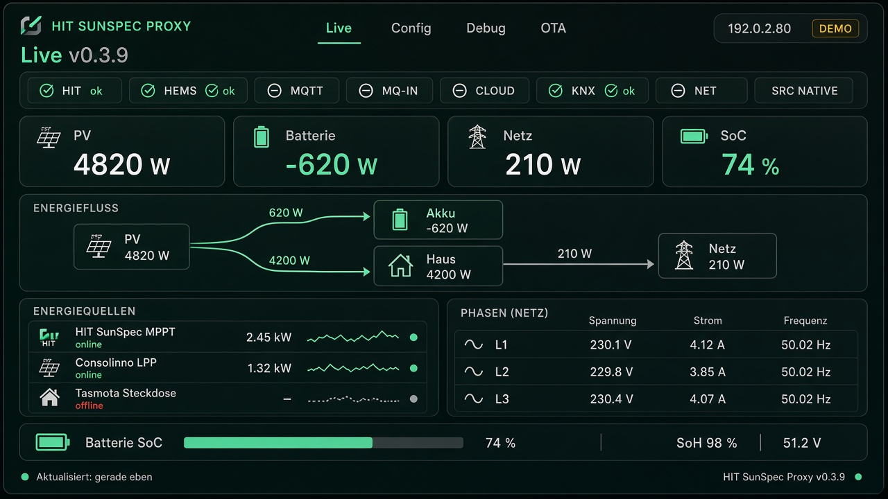
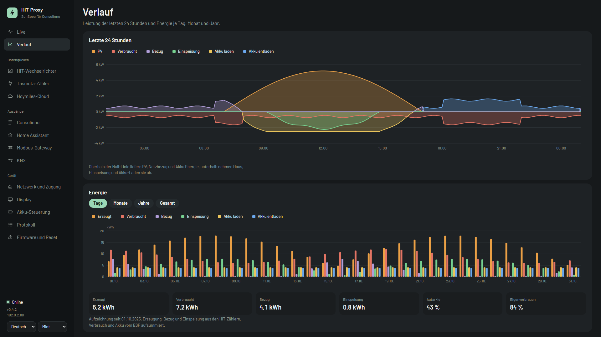
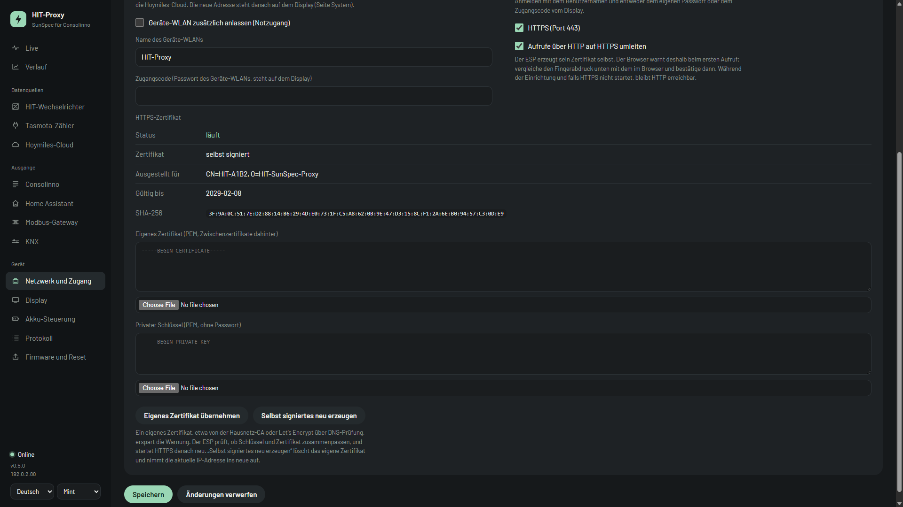
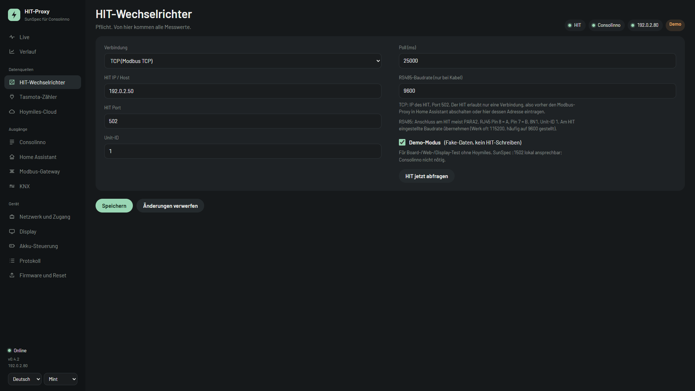
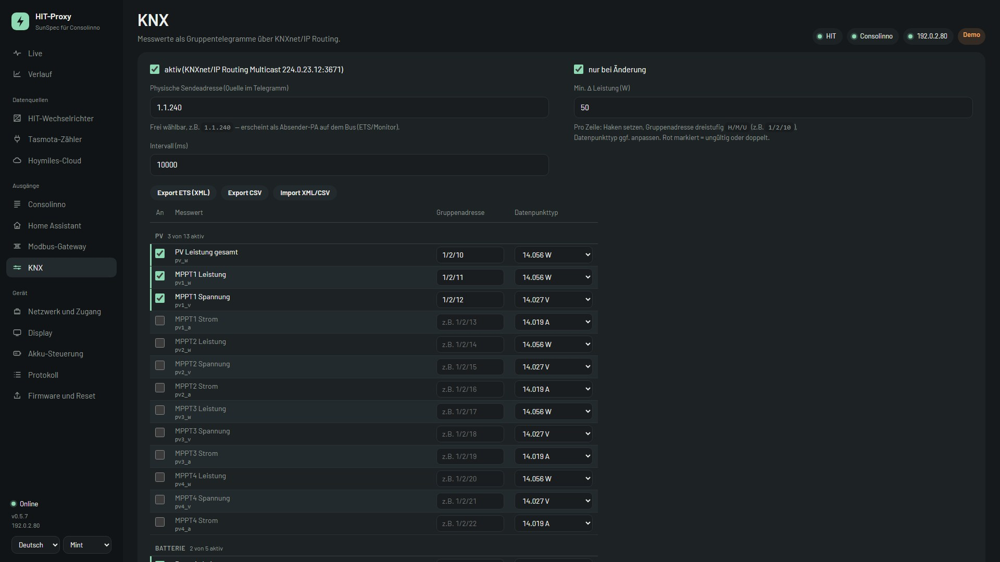

# HIT → Consolinno SunSpec Proxy (ESP32)

Autarker Modbus-Proxy: **Hoymiles HIT** → **Consolinno HEMS** (SunSpec GEN24 auf Port **1502**).
Der ESP hält die einzige HIT-Verbindung und verteilt die Daten an Consolinno, Home Assistant, KNX und
andere Modbus-Clients. Welche dieser Dienste laufen, wählst du im Einrichtungsassistenten; der Proxy
lässt sich auch ganz ohne Consolinno nutzen, z. B. nur als Modbus-Gateway mit KNX oder Home Assistant.

Zielboard: [LILYGO T-Connect-Pro](https://github.com/Xinyuan-LilyGO/T-Connect-Pro) (ESP32-S3, Ethernet W5500, Display, Touch, RS485). **Kein PoE**, 12–24 V DC.

Ohne Display auch auf **WT32-ETH01** (ESP32 + LAN8720, 4 MB Flash) und LilyGO T-POE-Pro, siehe [Build](#build).
Für den WT32-ETH01 gibt es ein [Hutschienengehäuse (2 TE, 12–24 V) zum Drucken](hardware/wt32-din/).

Aktuelle Firmware: **v0.5.8** — [Release mit `firmware.bin`](https://github.com/atomi23/hit-sunspec-proxy/releases/tag/v0.5.8)

### Neu in v0.5.8
- **Funktionsauswahl** im Einrichtungsassistenten und unter *Einstellungen, Funktionen*: Consolinno/SunSpec,
  Modbus-Gateway, Home Assistant, KNX, Tasmota-Zähler und Hoymiles-Cloud einzeln wählbar
- Nicht gewählte Dienste starten nicht und verschwinden aus Menü und Live-Seite; SunSpec (Port 1502) abschaltbar
- Wechselrichter-Typ als Einstellung vorbereitet (bisher nur Hoymiles HIT)
- Update per OTA von älteren Versionen: Einstellungen bleiben, kein erneuter Einrichtungsassistent

### v0.5.7
- **KNX:** Zuordnungstabelle nach Bereichen gruppiert, Zeilen hinterlegt, ungültige oder doppelte Adressen rot;
  **Import/Export der Gruppenadressen im ETS-Format** (XML und CSV)
- Neue Build-Variante **`wt32-eth01`**; `t-poe-pro` korrigiert (Takt, PHY-Reset, RS485-Pins, 16 MB Flash, PSRAM laut LilyGO)
- Schutz gegen CSRF: fremde Webseiten können über ein gespeichertes Login nichts mehr auslösen
- OTA-Update gehört genau einer Anfrage; Login wird vor dem Annehmen großer Anfragen geprüft
- Home Assistant: keine Zählerstände 0 mehr vor den ersten Daten (verhinderte doppelt gezählte Energie)
- Cloud: Zählerstände in Wh werden immer richtig umgerechnet, auch unter 10 kWh
- „Jetzt an HIT schreiben“ schreibt die gerade gespeicherten Werte; „HIT testen“ im Setup wartet auf eine frische Abfrage
- Tasmota: Absturz bei numerischer Zählernummer behoben, Zugangsdaten URL-kodiert
- Verlauf übersteht einen Stromausfall beim Speichern; KNX-Typnummern für Strom/Frequenz korrigiert (14.019/14.033)
- Ungültige Eingaben (Port 0, Unit-ID 0, leerer WLAN-Name …) werden nicht mehr gespeichert

### v0.5.6
- HIT-Poll in eigener FreeRTOS-Task (UI/Consolinno bleiben responsiv)
- Tasmota wählbar als Live-Netzzähler; optional SunSpec **Model 203** (3ph-Spoof aus Summe + HIT-Spannungen)
- KNX DPT9 korrekt skaliert; FC16 Power-Limit erst nach vollständigem Registersatz
- Web-Callbacks (Poll, HIT-Schreiben, Tasmota-Probe) laufen in der Hauptschleife, nicht im Async-Task
- Passwörter werden in `/api/config` nicht mehr im Klartext ausgeliefert
- `millis()`-Rollover-fest; Platform `espressif32 @ 53.3.13` gepinnt; eigene 16‑MB-Partitionstabelle

## Display am Gerät

Die drei Seiten auf dem T-Connect-Pro: Live, Strings und Netz, System. Demo-Daten.





## Architektur

```
                         ┌── SunSpec :1502 ──→ Consolinno HEMS
Hoymiles HIT ──TCP/RS485─┤── Modbus-Gateway :502 ──→ Home Assistant, andere Modbus-Clients
   (eine Verbindung)     ├── MQTT + Discovery ──→ Home Assistant
          ESP32          ├── KNX IP Routing ──→ KNX-Bus
                         └── Display, Web-UI, optional Tasmota-Zähler
```

| Pfad | Pflicht? | Rolle |
|------|----------|--------|
| HIT (Modbus TCP oder RS485) | ja | Datenquelle, einzige Verbindung zum HIT |
| SunSpec :1502 | ja | Consolinno HEMS (GEN24-Emulation, Modelle 1/103/120–124/160; optional Meter 203) |
| Modbus-Gateway | nein | Andere Modbus-Clients lesen den HIT über den ESP |
| MQTT | nein | HA-Sensoren per Discovery, optional MQTT als Ersatzquelle |
| KNX IP | nein | Multicast-Routing aller wählbaren Live-Werte |
| Tasmota | nein | Netzzähler für Live-View und optional SunSpec Model 203 |
| Hoymiles-Cloud | nein | S-Miles nur lesen, Ersatzquelle wenn HIT und MQTT ausfallen |
| HIT-Schreiben | nein | Akku-Grenzen 306–309, APC 279/280, standardmäßig aus |

## Screenshots

> Original-Oberfläche aus der Firmware (HTML/CSS aus `WebConfig.cpp` gerendert), Demo-Daten mit RFC‑5737-Adressen.

### Live



### Verlauf

Leistungsbilanz der letzten 24 Stunden: Quellen (PV, Netzbezug, Akku entladen) über der Null-Linie,
Verbraucher (Haus, Einspeisung, Akku laden) darunter. Darunter Energie je Tag, Monat, Jahr und gesamt.




### Protokoll

Systemprotokoll mit HIT-Ausfällen samt Ursache, Wiederkehr, Cloud-Status, OTA und Neustarts.
Die §14a-Writes von Consolinno stehen im zweiten Reiter.


### HTTPS

Selbst signiertes Zertifikat mit Fingerabdruck zum Vergleichen, oder ein eigenes hochladen.



### Einstellungen: HIT-Wechselrichter und KNX



KNX: je Messwert Gruppenadresse und Datenpunkttyp, nach Bereichen gruppiert. Die Adressen lassen sich als
ETS-Gruppenadressen-Export (XML oder CSV) herunterladen und in ETS 5/6 importieren, oder aus einem ETS-Export
übernehmen. Zugeordnet wird über die Beschreibung `hit-sunspec-proxy:<id>`, sonst über den Namen.



## Funktionen

- **Funktionsauswahl** im Einrichtungsassistenten und unter *Einstellungen, Funktionen*: SunSpec für Consolinno,
  Modbus-Gateway, Home Assistant, KNX, Tasmota und Cloud einzeln wählbar; nicht gewählte Dienste starten nicht
  und verschwinden aus dem Menü
- **Live-Seite** mit Energiefluss (PV, Akku, HIT, Netz, Haus), Ladestand-Ring, Strings, Phasen, Zählern
- **Verlauf** im ESP gespeichert (LittleFS): 24 h in 5-Minuten-Schritten, Tage, Monate, Jahre
- **Zwei Protokolle:** System (HIT, Cloud, OTA, Neustarts) und §14a-Writes von Consolinno;
  das Display zeigt HIT-Fehler als Fehler/Abfragen
- Oberfläche nutzt die volle Browserbreite
- **Menü nach Datenweg:** Datenquellen, Ausgänge, Gerät; ein Bereich pro Menüpunkt
- **Display** 480×222 mit kantengeglätteter Barlow-Schrift, drei Seiten (Live, Strings und Netz, System),
  einstellbarer Abschalt-Timeout, wacht bei Berührung oder HIT-Störung auf
- **HIT über TCP oder RS485** (Modbus RTU, TX 17 / RX 18), eine dauerhafte Verbindung für Lesen und Schreiben
- **Modbus-Gateway** (Port 502): Lesen immer, Schreiben nur mit Freigabe, jeder Schreibzugriff im Protokoll
- **SunSpec** GEN24-kompatibel, Abbild ab Adresse 0, 40000 und 50000
- **Schutz des Netzschutz-Bereichs:** FC6 auf HIT-Register 101–299 wird nie gesendet
  (laut Hoymiles V2.8 lädt das alle Netzschutz-Werkswerte)
- **HTTPS** auf Port 443, HTTP leitet um (außer während der Einrichtung). Selbst signiertes Zertifikat mit
  IP-Adresse und `<gerätename>.local`, wird bei neuer IP oder vor Ablauf selbst erneuert; eigenes Zertifikat
  (PEM, auch mit Zwischenzertifikaten) hochladbar, der ESP prüft ob Schlüssel und Zertifikat zusammenpassen
- **Werksreset**, **Neustart** (mit letztem Neustartgrund) und **OTA-Update** in der Weboberfläche
- **Zugangscode** jederzeit neu erzeugen; bleibt sonst über Neustarts und Updates erhalten
- **Heim-WLAN** zusätzlich zum Geräte-WLAN (Notzugang), Änderungen ohne Neustart
- **Live-Ansicht des Displays** in der Weboberfläche; Live-Seite bleibt stehen, automatisches Blättern optional
- Themes Mint, Ocean, Ember und Hell; Deutsch und Englisch (Web und Display)

## Inbetriebnahme

1. Erstes Flashen per USB: `pio run -e t-connect-pro -t upload`  
   (oder Release-`firmware.bin` unter *Firmware und Reset* per OTA — bei hängendem OTA vorher neu starten)
2. Das Display zeigt WLAN-Name, Zugangscode und einen QR-Code. Mit dem Geräte-WLAN verbinden.
3. Browser `http://192.168.4.1/` → Einrichtung (HIT-Adresse, Netzwerk)
4. Consolinno: Gerät als Fronius Hybrid / SunSpec, **Proxy-IP**, Port **1502**, Unit-ID **1**  
   (Scan nur auf 502 findet den Proxy nicht, solange SunSpec auf 1502 lauscht)
5. Danach läuft die Oberfläche über `https://<esp-ip>/`. Der Browser warnt beim ersten Aufruf, weil das
   Zertifikat selbst signiert ist; einmal bestätigen. Unter *Netzwerk und Zugang* steht danach der
   SHA-256-Fingerabdruck zum Vergleich mit dem im Browser. Ohne Warnung geht es mit einem eigenen Zertifikat.

Gibt es schon eine andere SunSpec-Quelle, lassen sich beide vergleichen:
`python tools/sunspec_check.py <alte-quelle> --compare <esp-ip>`. Andere Programme, die den HIT per Modbus
lesen, tragen danach `<esp-ip>:502` ein (Modbus-Gateway einschalten).

Pins: [`PINS.md`](PINS.md)

## Werkzeuge

| Skript | Zweck |
|--------|-------|
| `tools/sunspec_check.py` | SunSpec-Kette lesen, zwei Geräte vergleichen (Registerversatz) |
| `tools/parity_check.py` | Eine bestehende SunSpec-Karte gegen die ESP-Umrechnung derselben HIT-Daten prüfen (nur lesend) |
| `tools/make_vlw.py` | Display-Schriften (VLW) aus Barlow erzeugen |
| `tools/embed_fonts.py` | Web-Schriften (WOFF) einbetten |
| `tools/https_check.py` | HTTPS prüfen: Umleitung, Speichern, Zertifikat hochladen/ablehnen, optional OTA |
| `tools/esp_soak.py` | Lasttest der Weboberfläche über HTTP oder HTTPS, auch mit offen gehaltener Verbindung |
| `tools/modbus_watch.py` | SunSpec-Kennung laufend lesen, langsame Antworten und Ausfälle melden |
| `tools/serial_log.py` | Seriellen Log mitschreiben |

Zugangsdaten für die Werkzeuge kommen aus `ESP_USER` / `ESP_PASS`, nie aus dem Repo.

## Build

```bash
cd hit-sunspec-proxy
pio run -e t-connect-pro
pio run -e t-connect-pro -t upload
```

Platform und Partitionen sind im Repo festgelegt (`espressif32 @ 53.3.13`, `partitions_16MB.csv`:
2× ~4 MB OTA + ~8 MB LittleFS). Nach einem Partitionstabellen-Wechsel einmal per USB flashen;
OTA zwischen App-Slots bleibt danach möglich.

| Env | Board | Hinweise |
|-----|-------|----------|
| `t-connect-pro` (Standard) | LILYGO T-Connect-Pro, ESP32-S3, 16 MB | Display, Touch, W5500, RS485 TX 17 / RX 18 |
| `wt32-eth01` | WT32-ETH01, ESP32, 4 MB | ohne Display; LAN8720 (PHY 1, Takt GPIO0, Enable GPIO16); RS485 über externen Wandler mit Auto-Richtung an IO17 (TX) / IO5 (RX) |
| `t-poe-pro` | [LILYGO T-POE-Pro](https://lilygo.cc/products/t-poe-pro), ESP32-WROVER-E, 16 MB, 8 MB PSRAM | ohne Display; LAN8720 mit PoE; RS485 auf der Platine (TX 32 / RX 33) |

Der WT32-ETH01 nutzt `min_spiffs.csv` (2× 1,9 MB OTA), der T-POE-Pro wie der T-Connect-Pro `partitions_16MB.csv`.
Der WT32-ETH01 wird über einen USB-Seriell-Adapter an TX0/RX0 geflasht (IO0 beim Einschalten auf GND):

```bash
pio run -e wt32-eth01 -t upload
```

## Privatsphäre

Nur Pseudodaten (RFC‑5737 `192.0.2.x`). Keine echten Anlagenwerte, Adressen oder Zugangsdaten im Repo.
Gespeicherte Passwörter (Web, MQTT, Tasmota, Cloud) werden über die API nicht ausgeliefert;
leere Felder beim Speichern lassen bestehende Werte unverändert.

## Support & Donation

Lead Developer: [atomi23](https://github.com/atomi23)

<a href="https://www.paypal.me/atomi23"></a>

## Lizenz

MIT. Schrift Barlow: SIL Open Font License 1.1 ([`docs/FONT-LICENSE-OFL.txt`](docs/FONT-LICENSE-OFL.txt)).
