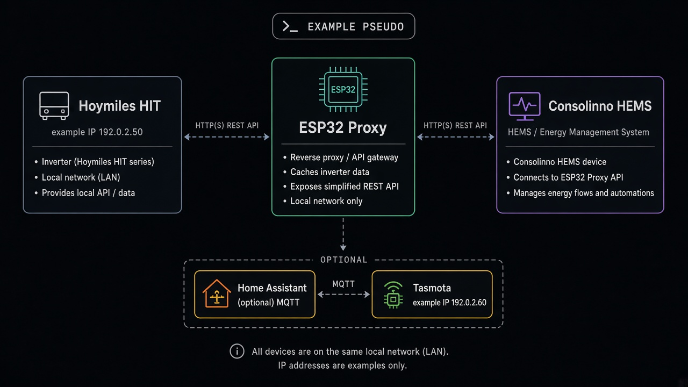
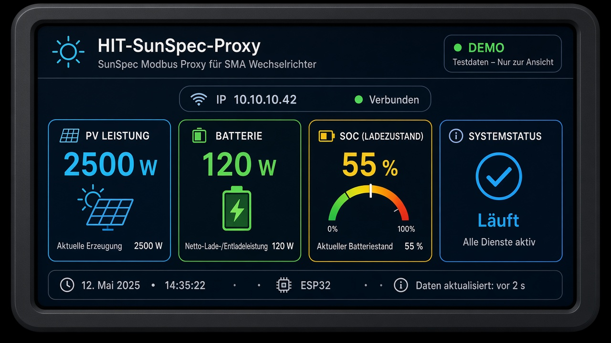

# HIT → Consolinno SunSpec Proxy (ESP32)

Autarker Modbus-Proxy: **Hoymiles HIT** → **Consolinno HEMS** (SunSpec GEN24 auf Port **1502**).

Zielboard: [LILYGO T-Connect-Pro](https://github.com/Xinyuan-LilyGO/T-Connect-Pro) (ESP32-S3, Ethernet W5500, Display, Touch). **Kein PoE** — 12–24 V DC.

Aktuelle Firmware: **v0.3.4**

## Architektur



```
Hoymiles HIT  --Modbus TCP-->  ESP Proxy (:1502 SunSpec)
                                      |
                                      +-- optional Tasmota (Display)
                                      +-- optional MQTT → Home Assistant
                                      +-- optional HIT Write (Akku/APC)
```

| Pfad | Pflicht? | Rolle |
|------|----------|--------|
| HIT → SunSpec | ja | Consolinno HEMS |
| Tasmota | nein | Display / optional Meter-Spoof |
| MQTT | nein | HA-Anzeige + Discovery |
| HIT Write | nein | Reg. 306–309 / APC (Web-Schalter) |

## Screenshots

### Web-UI (Config)


### Display (Live)



> Screenshots = **Mockups mit Pseudodaten** (keine echten IPs/Zählerstände aus einer Anlage).

## Features

- HIT Modbus TCP (Reg. **2000** PV-Energie, PV/Bat/SoC/V/I)
- SunSpec GEN24-Map auf **:1502** inkl. Model **123** (LPP von Consolinno)
- **Debug:** `/debug` — Log aller SunSpec-Writes (§14a-Test)
- **OTA:** `/ota` — `firmware.bin` per Browser (NVS-Config bleibt)
- **Demo-Modus** — Fake-Daten ohne HIT
- Dual-Auth: Display-Code (random) + selbst gewähltes Web-Passwort
- First-Boot: Setup-Screen mit IP + WLAN-QR
- MQTT Home Assistant Discovery
- Optional Tasmota E320 (`Power` / `E_in` / `E_out`)
- Optional HIT-Schreiben (306–309, APC) hinter Web-Schalter

## Erste Inbetriebnahme (Assistent)

1. `pio run -e t-connect-pro -t upload` (USB, einmalig)
2. Display: IP + Display-Code + WLAN-QR (First Boot)
3. Browser `http://<IP>/` → **Einrichtungsassistent** (`/setup`)
   - Zugang (Passwort)
   - HIT-IP (oder Demo) + Test-Poll
   - Consolinno: Proxy-IP / Port **1502** / Unit **1**
   - Abschließen → Setup-Screen aus, **autark HIT ↔ Consolinno**
4. HA/MQTT/Tasmota optional später in der normalen Config
5. OTA: `http://<IP>/ota`

Pins: [`PINS.md`](PINS.md)

## Build

```bash
cd hit-sunspec-proxy
pio run -e t-connect-pro
pio run -e t-connect-pro -t upload
pio device monitor
```

Velxio-Smoke-Test (nur Serial/LED): [`velxio-demo/velxio-demo.ino`](velxio-demo/velxio-demo.ino)

## Privatsphäre / Pseudodaten

Im Repo liegen **nur Beispielwerte** (RFC‑5737 `192.0.2.x`, Demo-kWh). Keine echten LAN-IPs, Zählerstände oder Seriennummern einer Anlage. Defaults nach dem Flash bitte in der Web-UI auf deine Umgebung setzen.

## Support & Donation

Dieses Projekt wurde mit viel ❤️, ☕ und KI-Unterstützung entwickelt.  
Lead Developer: [atomi23](https://github.com/atomi23)

<a href="https://www.paypal.me/atomi23"></a>

## Lizenz

MIT
