# Web UI and display

[Deutsch](./web-ui.md) · **English** · [Back to overview](../README.en.md)

## Display on the device

The three pages on the T-Connect-Pro: Live, Strings and grid, System. Demo data.

Under **Settings → Display** you can optionally set up a weekly schedule with one time window per weekday.
An earlier off time applies to the following day; equal times mean on all day. As soon as the clock is
synchronized (Central European local time incl. daylight saving time), the schedule replaces the inactivity timer
and the automatic backlight on HIT faults. The web live view keeps running even with the backlight
switched off.

Under **Settings → KNX** you can assign your own group address to the receive object **Switch display**.
A GroupValueWrite with DPT **1.001** switches on at `1` and off at `0`. A KNX command
overrides the weekly schedule until the next change between on and off; without a schedule the last
command applies until the next switch command or restart. The QR code setup stays lit while the
display is enabled.

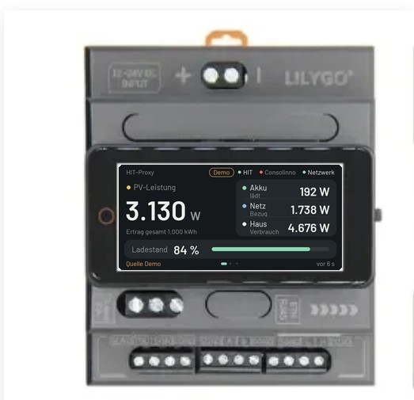
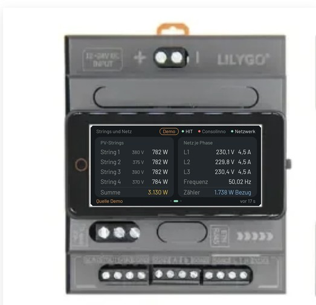
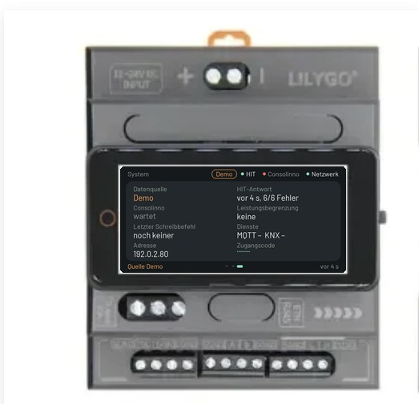

## Screenshots

> Example screenshots from earlier firmware versions, with demo data and RFC 5737 addresses. They show the German UI and may differ from the current version.

The static web previews in `docs/ui-preview/` show sample data. To view them locally, run
`python3 -m http.server --bind 127.0.0.1 --directory docs/ui-preview` and open, for example,
`http://127.0.0.1:8000/system.html` for Overview or `http://127.0.0.1:8000/bluetooth.html`
for Bluetooth. Add `?lang=en` to switch the preview to English.

### Overview

**Device → Overview** shows the board, chip, flash, firmware version, build date, uptime and last
start, as well as network addresses and service status. It also shows CPU load per core as the
share of time spent outside idle, averaged over two seconds. Bars show usage of internal memory,
PSRAM when present, and LittleFS.

### Live

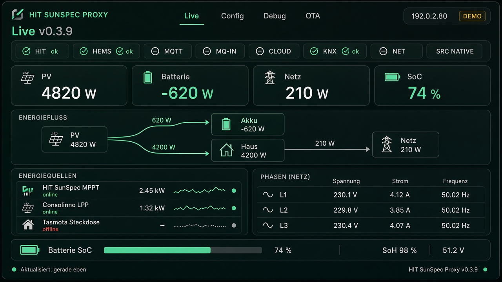

### Blueprint design

Selectable like the other designs, but with its own menu navigation and an energy band on the live page.

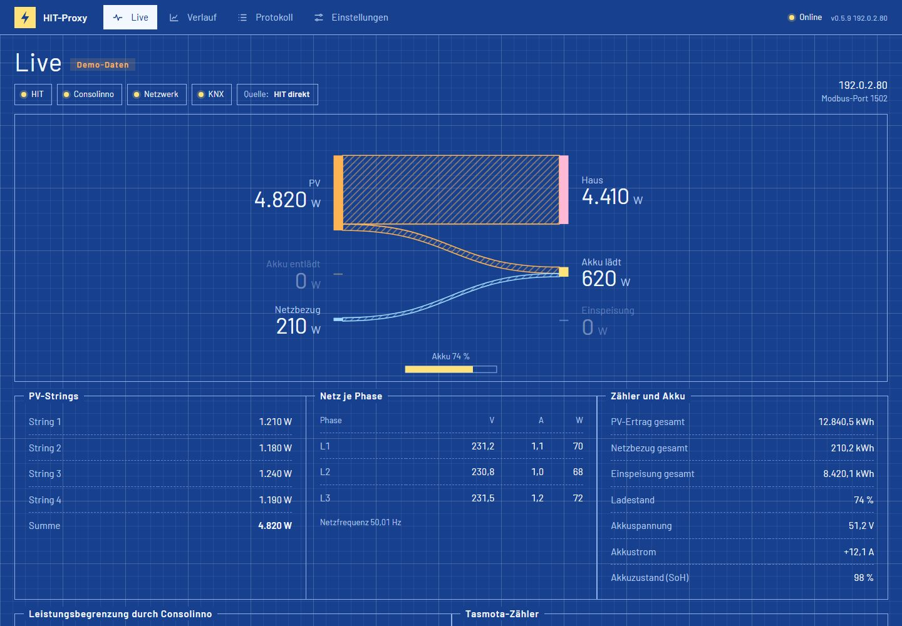

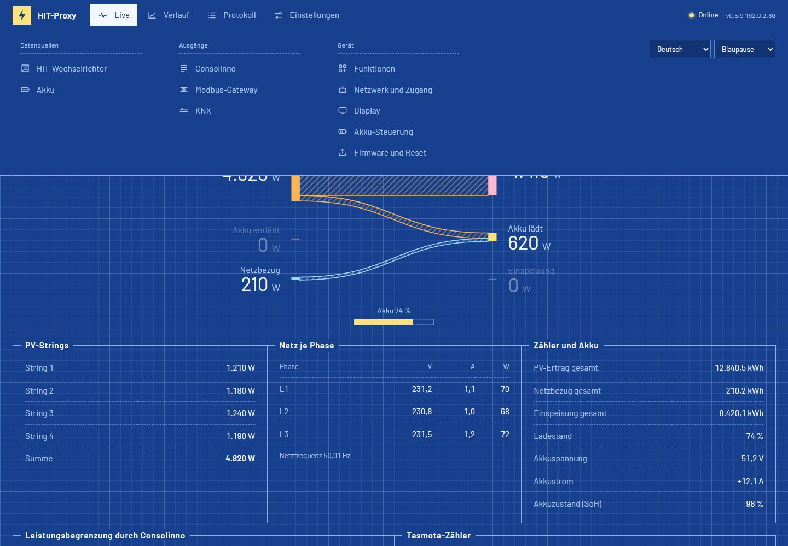

### History

Power over the last 24 hours: PV, grid import and battery discharge appear as filled areas; household
consumption and battery charging appear as lines above zero. Only feed-in is below zero in **Balance**
view; **All positive** also shows it above zero. Energy per day, month, year and total appears below.
History data can be downloaded as CSV.

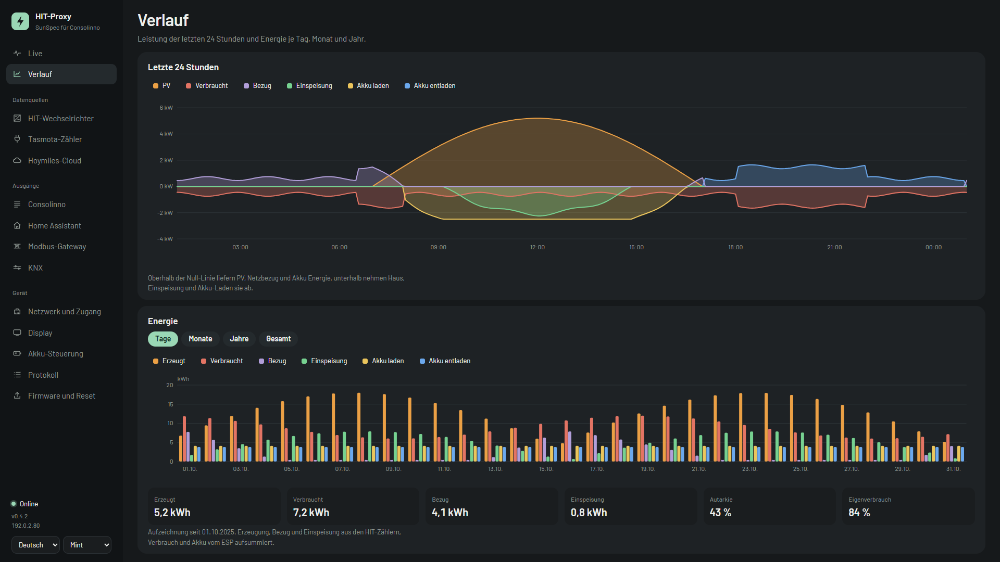

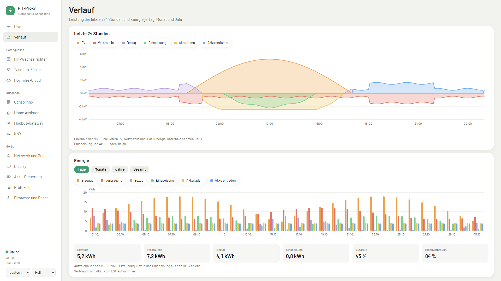

### Log

The system log shows HIT outages and their cause, recovery, cloud status, OTA and restarts, as well as
Bluetooth connections and sent LED commands on the T-Connect-Pro. Consolinno's §14a writes are in the
second tab. Both logs can be downloaded as text files.

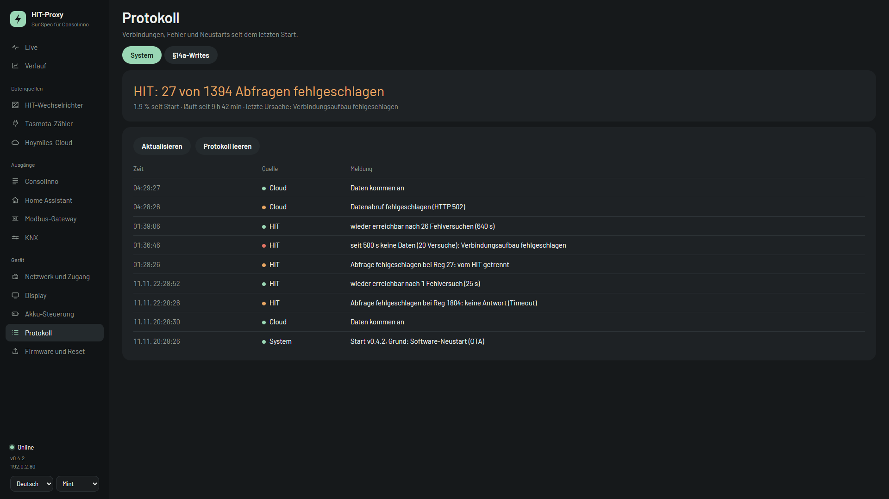

### HTTPS

On supported boards, TLS uses available PSRAM for its allocations. This reduces internal RAM
pressure, particularly on the T-Connect-Pro with Bluetooth. On the WT32-ETH01 without PSRAM,
the web UI stays on HTTP.

The device CA signs the server certificate with IP addresses and `<devicename>.local` (820 days).
The CA is created once, issued for about ten years, and survives IP changes and
"Regenerate self-signed"; only a factory reset deletes it. Old self-signed
server certificates are switched over automatically; uploaded custom certificates stay unchanged.
If switching to the CA fails, a matching stored certificate stays in use;
if there is none, a self-signed fallback certificate is created. The next boot tries the CA again.
The fallback may trigger a browser warning. Without a running HTTPS server there is no HTTP redirect.

For HTTPS without a browser warning, choose **Download CA certificate** under *Network and access*
(`/api/tls/ca.crt`, public and also reachable over HTTP; contains no private key). Compare the displayed CA SHA-256 fingerprint
over a trusted connection and install the CA once per client as a root CA:
- Windows:
  1. Double-click `hit-proxy-ca.crt` → **Install Certificate** → **Current User**.
  2. **Place all certificates in the following store** → **Browse** → choose **Trusted Root Certification Authorities**; finish the installation and confirm the security prompt with **Yes**.
  3. Restart the browser completely.
  **Important:** Automatic store selection puts the certificate in the wrong store; Chrome then shows `NET::ERR_CERT_AUTHORITY_INVALID`.
- macOS: **Keychain Access**, **Always Trust**
- iOS: **Install Profile**, then enable it under **Certificate Trust Settings**
- Android: install as **CA certificate**
- Firefox: if needed, also import it into Firefox's own certificate store

Then open `https://<ip>` or `https://<name>.local`. On an IP change only the
server certificate is renewed; the CA does not have to be installed again. The CA may only sign names under
`.local` / `.home.arpa` and private IPv4 networks (10/8, 172.16/12, 192.168/16, 169.254/16).
Custom certificates (PEM, also with intermediate certificates) can still be uploaded.

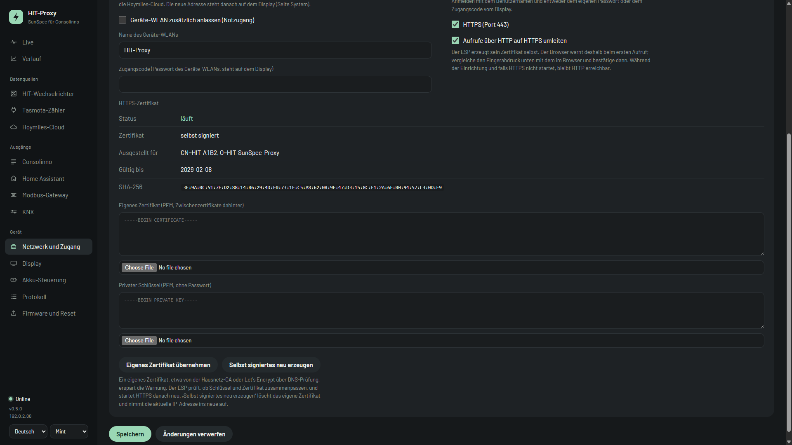

### Settings: HIT inverter and KNX

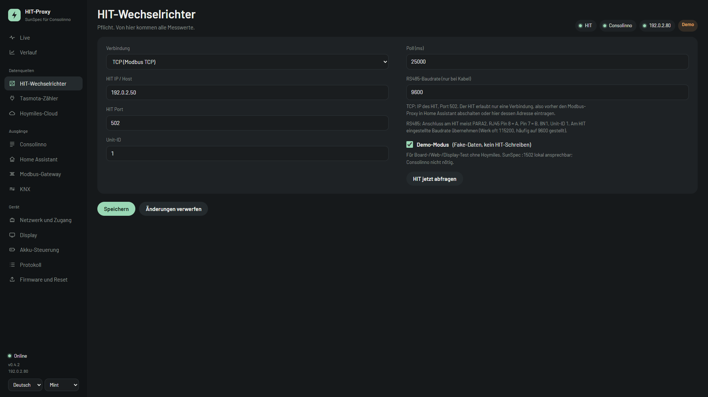

KNX: group address and datapoint type per measurement, grouped by area. The addresses can be downloaded as an
ETS group address export (XML or CSV) and imported into ETS 5/6, or taken over from an ETS export.
Matching uses the description `hit-sunspec-proxy:<id>`, otherwise the name.

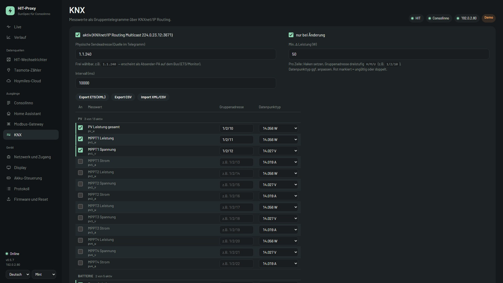
