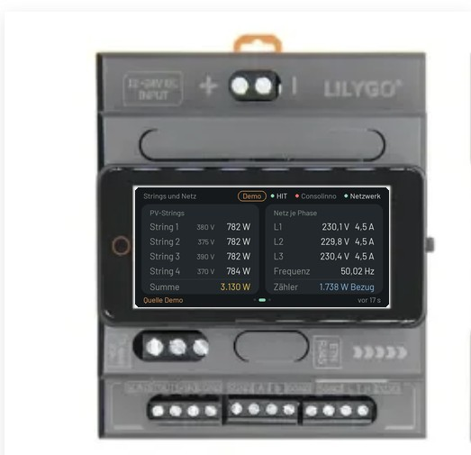
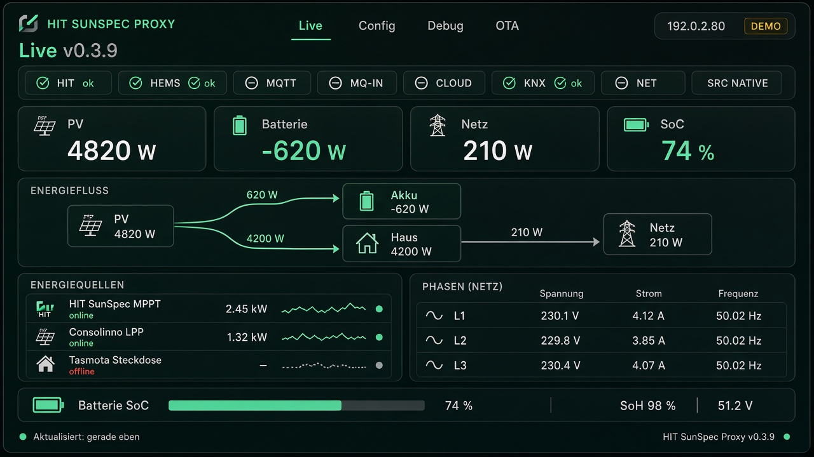
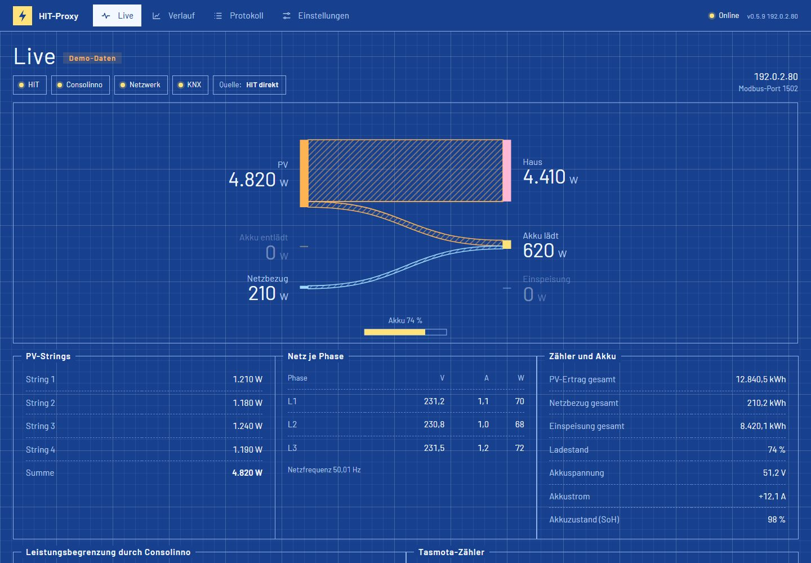
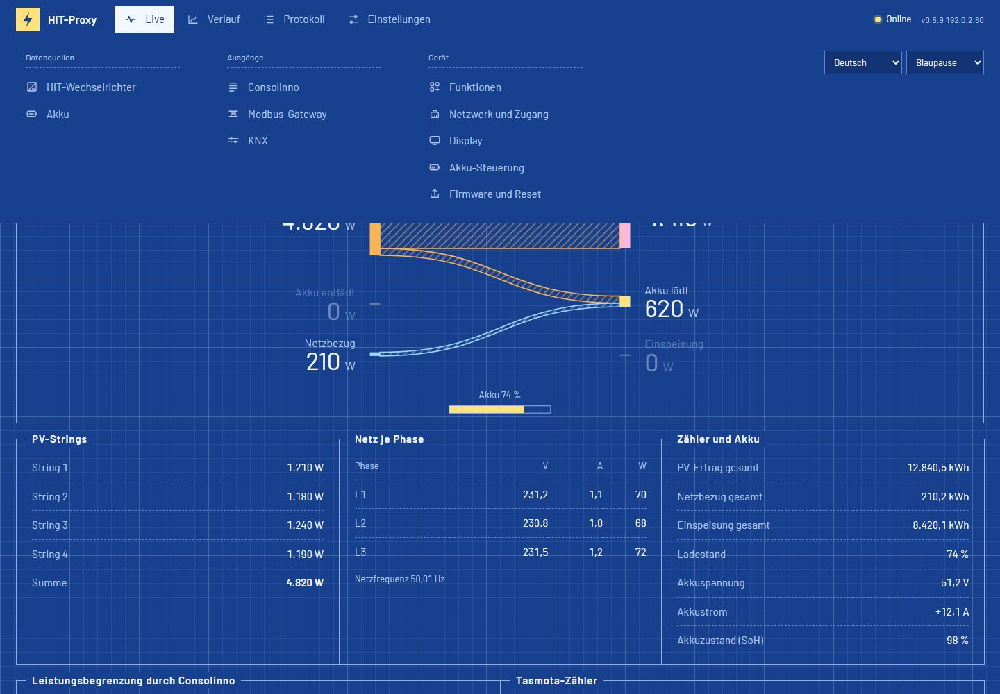
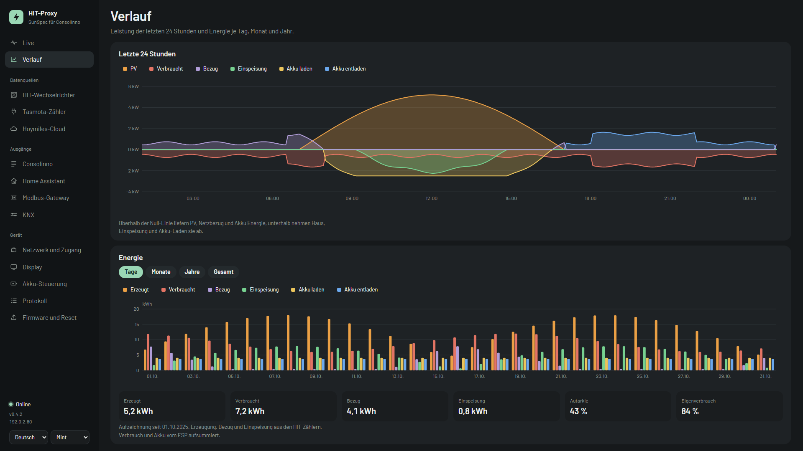
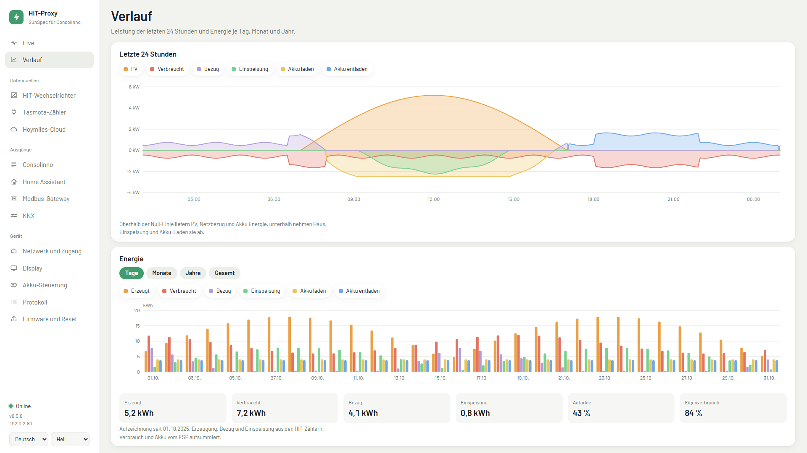
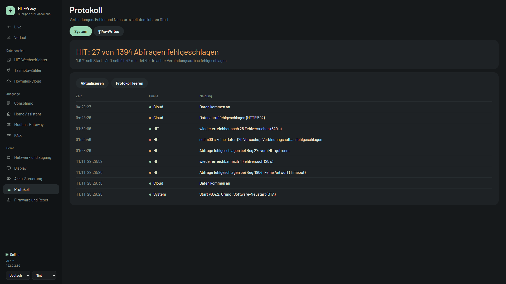
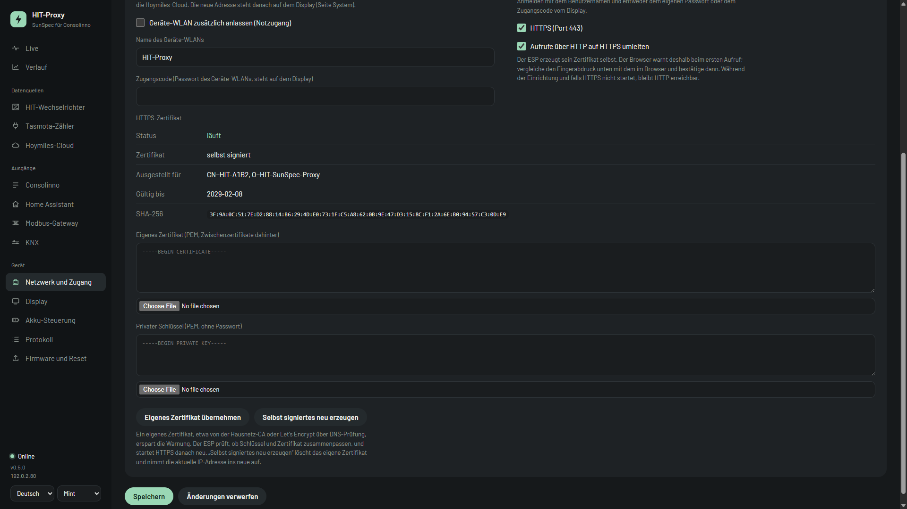
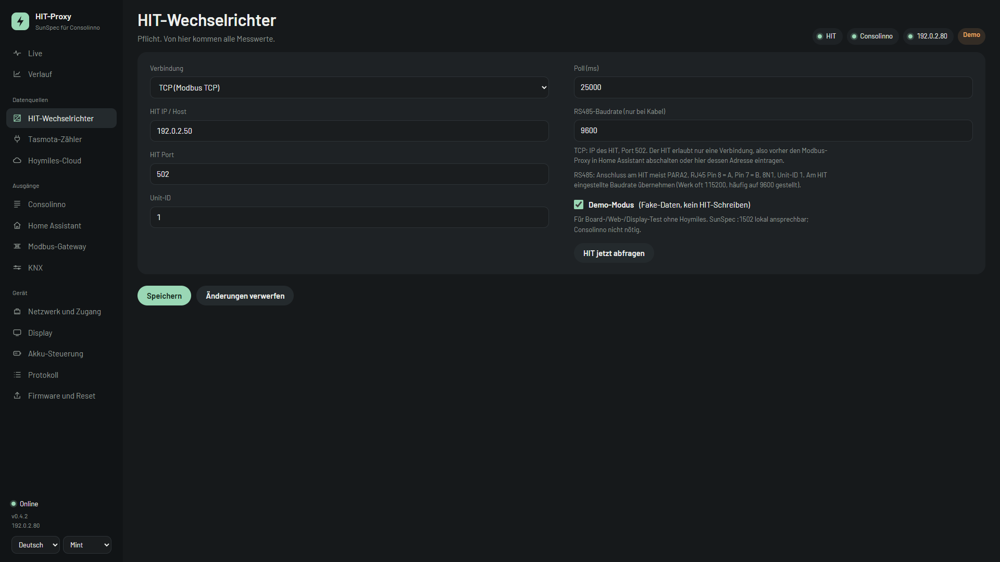
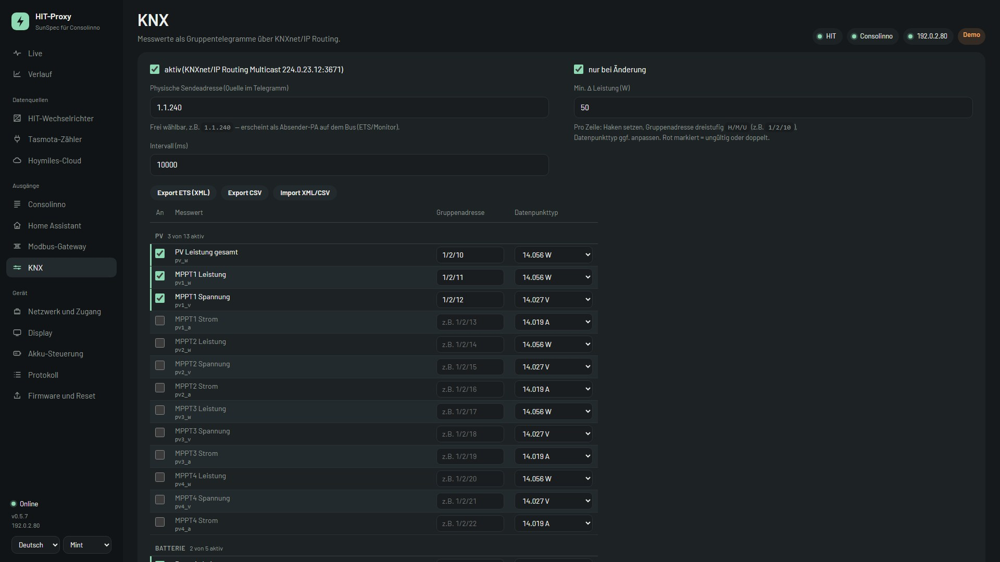

# Weboberfläche und Display

**Deutsch** · [English](./web-ui.en.md) · [Zur Übersicht](../README.md)

## Display am Gerät

Die drei Seiten auf dem T-Connect-Pro: Live, Strings und Netz, System. Demo-Daten.

Unter **Einstellungen → Display** lässt sich optional ein Wochenplan mit einem Zeitfenster pro Wochentag
einrichten. Eine frühere Aus-Zeit gilt am Folgetag, gleiche Zeiten bedeuten ganztägig an. Sobald die Uhr
synchronisiert ist (mitteleuropäische Ortszeit inkl. Sommerzeit), ersetzt der Plan den Inaktivitäts-Timer
und die automatische Beleuchtung bei HIT-Störungen. Die Web-Live-Ansicht läuft auch bei ausgeschalteter
Beleuchtung weiter.

Unter **Einstellungen → KNX** kann man dem Empfangsobjekt **Display schalten** eine eigene Gruppenadresse
zuweisen. Ein GroupValueWrite mit DPT **1.001** schaltet bei `1` ein und bei `0` aus. Ein KNX-Befehl
übersteuert den Wochenplan bis zum nächsten Wechsel zwischen An und Aus; ohne Plan gilt der letzte
Befehl bis zum nächsten Schaltbefehl oder Neustart. Die Einrichtung mit QR-Code wird bei aktiviertem
Display weiterhin beleuchtet.

## Screenshots

> Beispielaufnahmen aus früheren Firmware-Versionen mit Demo-Daten und RFC‑5737-Adressen. Die aktuelle Oberfläche kann davon abweichen.

Die statischen Web-Vorschauen unter `docs/ui-preview/` zeigen Beispieldaten. Zum lokalen Ansehen
`python3 -m http.server --bind 127.0.0.1 --directory docs/ui-preview` starten und z. B.
`http://127.0.0.1:8000/system.html` für die Übersicht oder `http://127.0.0.1:8000/bluetooth.html`
für Bluetooth öffnen. Mit `?lang=en` schaltet die Vorschau auf Englisch um.

### Übersicht

Unter **Gerät → Übersicht** stehen Board, Chip, Flash, Firmwareversion, Baudatum, Laufzeit und letzter
Start sowie Netzwerkadressen und der Status der Dienste. Die Seite zeigt außerdem die CPU-Last je Kern
als Anteil der Zeit außerhalb des Leerlaufs, gemittelt über zwei Sekunden. Balken zeigen die Belegung
von internem Arbeitsspeicher, vorhandenem PSRAM und LittleFS.

### Live

### Design Blaupause

Wählbar wie die anderen Designs, aber mit eigener Menüführung und einem Energieband auf der Live-Seite.

### Verlauf

Leistung der letzten 24 Stunden: PV, Netzbezug und Akkuentladung erscheinen als Flächen, Hausverbrauch
und Akkuladung als Linien oberhalb der Null-Linie. Nur die Einspeisung liegt in der Ansicht **Bilanz**
unterhalb der Null-Linie; mit **Alles positiv** erscheint auch sie oberhalb. Darunter steht die Energie
je Tag, Monat, Jahr und gesamt. Die Verlaufsdaten lassen sich als CSV herunterladen.

### Protokoll

Systemprotokoll mit HIT-Ausfällen samt Ursache, Wiederkehr, Cloud-Status, OTA und Neustarts sowie
Bluetooth-Verbindungen und gesendeten LED-Befehlen auf dem T-Connect-Pro. Die §14a-Schreibzugriffe
von Consolinno stehen im zweiten Reiter. Beide Protokolle lassen sich als Textdatei herunterladen.

### HTTPS

Auf unterstützten Boards nutzt TLS verfügbaren PSRAM für seine Speicherzuweisungen. Das entlastet
den internen RAM insbesondere beim T-Connect-Pro mit Bluetooth. Auf dem WT32-ETH01 ohne PSRAM bleibt
die Oberfläche bei HTTP.

Die Geräte-CA signiert das Serverzertifikat mit IP-Adressen und `<gerätename>.local` (820 Tage).
Die CA wird einmal erzeugt, für etwa zehn Jahre ausgestellt und bleibt bei IP-Wechseln und
„Selbst signiertes neu erzeugen“ erhalten; nur ein Werksreset löscht sie. Alte selbst signierte
Serverzertifikate werden automatisch umgestellt; hochgeladene eigene Zertifikate bleiben unverändert.
Bei einem Fehler der CA-Umstellung bleibt ein passendes gespeichertes Zertifikat in Betrieb;
fehlt es, wird ein selbst signiertes Ersatz-Zertifikat erzeugt. Der nächste Start versucht die CA erneut.
Der Ersatz kann eine Browserwarnung auslösen. Ohne laufenden HTTPS-Server erfolgt keine HTTP-Umleitung.

Für HTTPS ohne Browserwarnung unter *Netzwerk und Zugang* **CA-Zertifikat herunterladen** wählen
(`/api/tls/ca.crt`, öffentlich und auch über HTTP erreichbar; enthält keinen privaten Schlüssel). Den angezeigten CA-SHA-256-Fingerabdruck
über eine vertrauenswürdige Verbindung vergleichen und die CA einmal pro Client als Stamm-CA installieren:
- Windows:
  1. Doppelklick auf `hit-proxy-ca.crt` → **Zertifikat installieren** → **Aktueller Benutzer**.
  2. **Alle Zertifikate in folgendem Speicher speichern** → **Durchsuchen** → **Vertrauenswürdige Stammzertifizierungsstellen** wählen; Installation abschließen und die Sicherheitsabfrage mit **Ja** bestätigen.
  3. Browser komplett neu starten.
  **Wichtig:** Die automatische Speicherauswahl legt das Zertifikat im falschen Speicher ab; Chrome zeigt dann `NET::ERR_CERT_AUTHORITY_INVALID`.
- macOS: **Schlüsselbund**, **Immer vertrauen**
- iOS: **Profil installieren**, danach unter **Zertifikatsvertrauenseinstellungen** aktivieren
- Android: **CA-Zertifikat** installieren
- Firefox: ggf. zusätzlich in den eigenen Zertifikatsspeicher importieren

Danach `https://<ip>` oder `https://<name>.local` öffnen. Bei einem IP-Wechsel wird nur das
Serverzertifikat erneuert; die CA muss nicht erneut installiert werden. Die CA darf nur Namen unter
`.local` / `.home.arpa` und private IPv4-Netze (10/8, 172.16/12, 192.168/16, 169.254/16) signieren.
Eigene Zertifikate (PEM, auch mit Zwischenzertifikaten) können weiterhin hochgeladen werden.

### Einstellungen: HIT-Wechselrichter und KNX

KNX: je Messwert Gruppenadresse und Datenpunkttyp, nach Bereichen gruppiert. Die Adressen lassen sich als
ETS-Gruppenadressen-Export (XML oder CSV) herunterladen und in ETS 5/6 importieren, oder aus einem ETS-Export
übernehmen. Zugeordnet wird über die Beschreibung `hit-sunspec-proxy:<id>`, sonst über den Namen.

