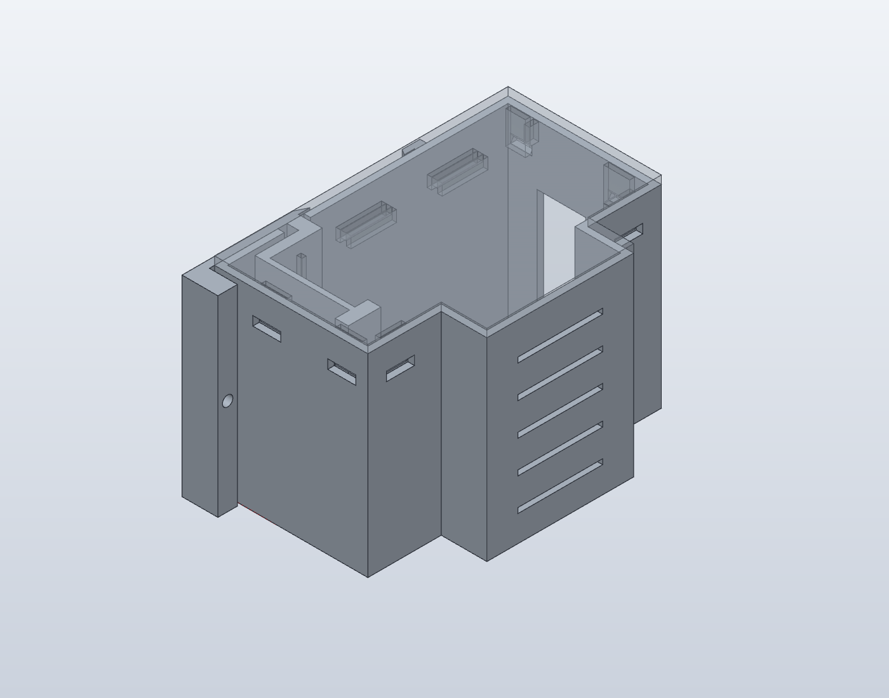
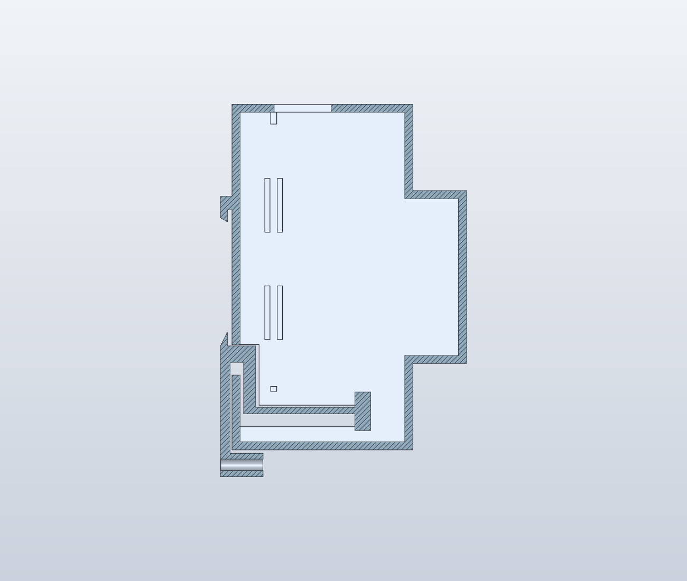

# Hutschienengehäuse für Waveshare ESP32-P4-WIFI6-POE-ETH (3,5 TE, ohne Schrauben)



Gehäuse für die Firmware-Variante `p4-poe-eth`: 62 × 90 mm (3,5 TE), Tiefe ab Schiene 61 mm, Frontstufe
45 mm breit. Versorgung und Netz über ein PoE-Kabel, keine weiteren Klemmen.

Die Platine misst 55 × 68 mm. Schmaler als 3,5 TE geht nicht, weil sie quer zur Schiene 55 mm breit ist.
Sie steht parallel zur Hutschiene, Bauteile nach vorn, LAN und USB oben.

> **Noch nicht gedruckt.** Die Lage von LAN- und USB-Buchse stammt aus der Maßzeichnung des Händlers
> (USB 4,5–20,3 mm, LAN 21,5–38,1 mm von der Kante, Buchsen 3 mm über der Platine). Vor dem Druck an der
> echten Platine nachmessen; alle Maße stehen oben in [`gen_case.py`](gen_case.py).

## Teile

| Datei | Druckt auf | Hinweis |
|-------|------------|---------|
| `stl/unterteil.stl` | Seitenwand | ohne Stützmaterial; Feder und Riegel liegen auf dem Bett |
| `stl/deckel.stl` | Außenseite | schon gedreht, Zungen zeigen nach oben |

PETG empfohlen, 0,2 mm Schicht, 3 Wände, 20 % Füllung. Die erste Schicht muss sauber sein: Riegel und Feder
sind nur durch 0,6 bis 1 mm Spalt vom Gehäuse getrennt.

## Aufbau

- Platine mit den Buchsen nach oben in das Unterteil stecken. Die eine Kante sitzt in zwei Nuten an
  der Seitenwand (1,2 mm tief, die FPC-Buchsen liegen 2 mm von der Kante). Unten liegt sie auf, oben
  hält ein Anschlag neben den Buchsen. Die andere Kante fassen die Nuten im Deckel.
- Deckel auflegen und andrücken, bis die sechs Zungen einrasten. Zum Lösen die Rastnasen durch die
  Fenster oben, unten und vorn nach innen drücken.
- Hutschiene: oben einhängen, unten andrücken. Lösen: Schraubendreher in das Loch der Lasche unten
  stecken und nach unten ziehen.
- Die TF-Karte ist im Gehäuse nicht erreichbar; die Firmware braucht sie nicht.
- Die WLAN-Antenne des ESP32-C6 (IPEX) bleibt im Gehäuse. Wird WLAN gebraucht, die Antenne innen an die
  Vorderwand kleben.



Schnitt bei 30 mm: oben der Ausschnitt für die Buchsen, links der feste Haken, unten der Riegel. Die Feder
liegt waagrecht unter der Platine, ein Steg hinter der Platine verbindet sie mit dem Riegel.

## Neu erzeugen

```bash
python gen_case.py
solidcraft-cli run case.json --save p4-poe-din.sc --script-relative
```
