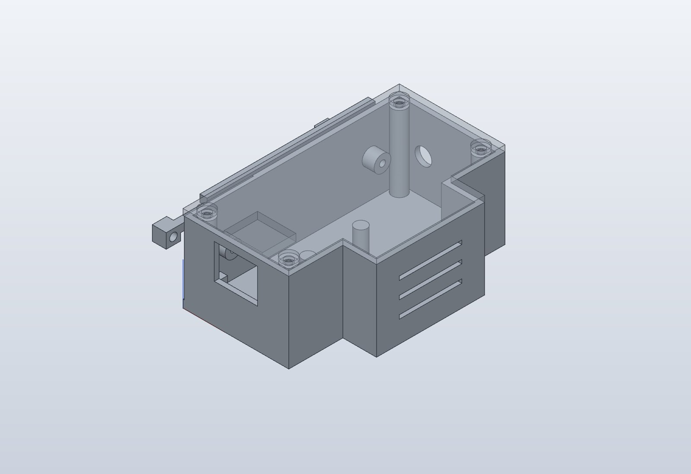

# Hutschienengehäuse für WT32-ETH01 (2 TE)



Gehäuse für die Firmware-Variante `wt32-eth01`: 36 × 90 mm (2 TE), Tiefe ab Schiene 61 mm,
Frontstufe 45 mm breit für den Ausschnitt einer Verteilerabdeckung. Versorgung 12–24 V DC über einen
kleinen Step-down-Wandler auf 5 V im Gehäuse.

> **Erste Version, noch nicht gedruckt.** Die Platinenmaße stammen aus Datenblatt und Fotos
> (60 × 26 mm, LAN-Buchse ca. 16 × 13,5 mm). Vor dem Einbau einen Probedruck mit der echten Platine prüfen;
> alle Maße stehen oben in [`gen_case.py`](gen_case.py).

## Teile

| Datei | Druckt auf | Hinweis |
|-------|------------|---------|
| `stl/unterteil.stl` | Seitenwand | ohne Stützmaterial |
| `stl/deckel.stl` | Außenseite | schon gedreht |
| `stl/clip.stl` | Gehäuseseite | schon gedreht; Federarm biegt sich in der Druckebene |

PETG empfohlen (Federarm und Wärme im Verteiler), 0,2 mm Schicht, 3 Wände, 20 % Füllung.

## Zusätzlich nötig

- Step-down 12–24 V → 5 V, max. ca. 38 × 22 mm (z. B. Mini-360 oder MP1584). Nicht die 5-V-Leitung
  direkt mit 12 V versorgen, der Spannungsregler der WT32-ETH01 verträgt das nicht.
- Optional RS485-Modul (TTL ↔ RS485 mit automatischer Richtungsumschaltung) an IO17 (TX) / IO5 (RX),
  Platz in der Frontstufe
- 4 Blechschrauben 2,9 × 9,5 mm oder M3 × 10 selbstschneidend (Deckel)
- 2 Schrauben M3 × 10 (Clip ans Unterteil)
- Doppelseitiges Schaumklebeband für Platine, Wandler und Modul

## Aufbau

- Die LAN-Buchse zeigt nach unten durch den Boden. Die Platine liegt auf zwei Stützen und zwei Leisten,
  der Niederhalter im Deckel drückt auf die Buchse.
- Unter der Platine bleiben 13 mm für die Stiftleisten. Litzen direkt an die Stifte löten, für
  Dupont-Stecker reicht der Platz nicht.
- Oben zwei Kabeldurchführungen (Ø 7 mm): Versorgung 12–24 V und RS485 A/B/GND.
- Clip: oben in die Schiene einhängen, unten einrasten. Zum Lösen einen Schraubendreher in die Lasche
  unten stecken und nach unten ziehen.

## Neu erzeugen

Das Modell ist mit SolidCraft gebaut. `gen_case.py` schreibt die
Befehlsfolge `case.json`, die SolidCraft ausführt:

```bash
python gen_case.py
solidcraft-cli run case.json --save wt32-din.sc
```

`wt32-din.sc` lässt sich in SolidCraft öffnen und weiter bearbeiten; die STL-Dateien landen in `stl/`.
