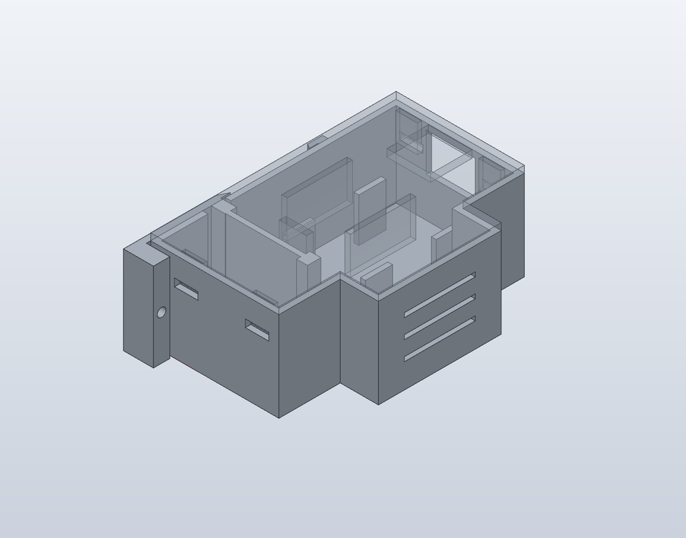
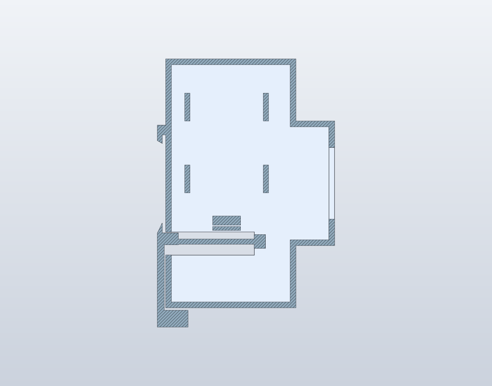

# Hutschienengehäuse für WT32-ETH01 (2 TE, ohne Schrauben)



Gehäuse für die Firmware-Variante `wt32-eth01`: 35,5 × 90 mm (2 TE), Tiefe ab Schiene 61 mm,
Frontstufe 45 mm breit für den Ausschnitt einer Verteilerabdeckung. Zwei Teile, keine Schrauben:

- **Hutschienen-Clip am Unterteil angedruckt.** Oben ein fester Haken, unten ein federnder Riegel.
- **Deckel rastet ein.** Vier Federzungen greifen in Fenster oben und unten im Unterteil.
- **Platine geklemmt, Unterseite frei.** Unter der Platine bleiben 13 mm für Stiftleisten oder eine
  PoE-Adapterplatine auf dem Rücken.

> **Noch nicht gedruckt.** Platinenmaße aus Datenblatt und Fotos (Platine 57 × 26 mm, Buchse steht
> 3 mm über, 13,5 mm hoch). Vor dem Einbau mit der echten Platine prüfen; alle Maße stehen oben in
> [`gen_case.py`](gen_case.py).

## Varianten

| Ordner | Für | Öffnungen |
|--------|-----|-----------|
| `stl/poe/` | nur WT32-ETH01 mit PoE-Adapter auf dem Rücken | nur LAN-Buchse (plus Lüftungsschlitze und Rastfenster) |
| `stl/rs485/` | WT32-ETH01 mit Step-down 12–24 V und RS485-Modul | zusätzlich zwei Kabeldurchführungen unten |

Der Deckel ist bei beiden gleich.

## Teile

| Datei | Druckt auf | Hinweis |
|-------|------------|---------|
| `unterteil.stl` | Seitenwand | ohne Stützmaterial; Feder und Riegel liegen auf dem Bett |
| `deckel.stl` | Außenseite | schon gedreht, Zungen zeigen nach oben |

PETG empfohlen (Feder, Rastzungen, Wärme im Verteiler), 0,2 mm Schicht, 3 Wände, 20 % Füllung.
Die erste Schicht muss sauber sein: Spalte von 0,5 bis 0,6 mm trennen Riegel und Feder vom Gehäuse.
Zusammengewachsene Stellen mit einem Messer lösen.

## Aufbau

- Die LAN-Buchse zeigt nach oben. Ihre Unterseite liegt auf der Kante des Ausschnitts, der
  Niederhalter im Deckel drückt von oben. Am anderen Ende liegt die Platine auf einer Stütze und wird
  von einem Stempel im Deckel gehalten; zwei Stege drücken auf die Stiftleisten. Seitlich führen vier
  Leisten die Platine.
- Nur Variante `rs485`: unten zwei Kabeldurchführungen (Ø 7 mm) für 12–24 V bzw. RS485. Darüber, unter der Feder, ist Platz
  für einen Step-down-Wandler (bis ca. 40 × 15 mm, z. B. Mini-360 oder MP1584). Nicht die 5-V-Leitung
  direkt mit 12 V versorgen. Mit PoE-Adapter auf dem Rücken entfällt der Wandler.
- Frontstufe innen 14 × 41 mm, z. B. für ein RS485-Modul.
- Deckel: auflegen und andrücken, bis alle vier Zungen einrasten. Lösen: die Rastnasen mit einem
  kleinen Schraubendreher durch die Fenster nach innen drücken.
- Hutschiene: oben einhängen, unten andrücken, der Riegel rastet ein. Lösen: Schraubendreher in das
  Loch der Lasche unten stecken und nach unten ziehen.



Schnitt bei 10 mm: links oben der feste Haken, unten der Riegel mit der waagrechten Feder und der
Zuglasche hinter der Rückwand.

## Neu erzeugen

```bash
python gen_case.py poe
solidcraft-cli run case_poe.json --save wt32-din-poe.sc --script-relative
python gen_case.py rs485
solidcraft-cli run case_rs485.json --save wt32-din-rs485.sc --script-relative
```

Die `.sc`-Dateien lassen sich in SolidCraft öffnen; die STL-Dateien landen in `stl/poe/` bzw. `stl/rs485/`.
